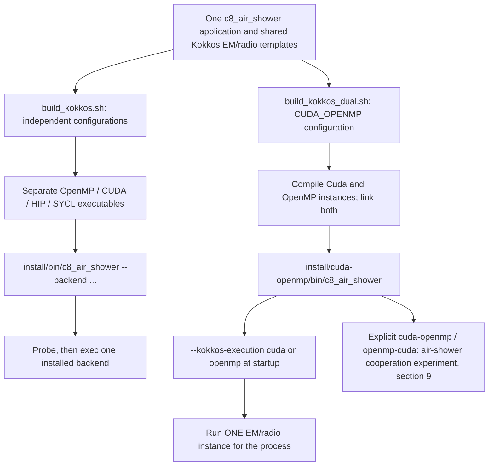
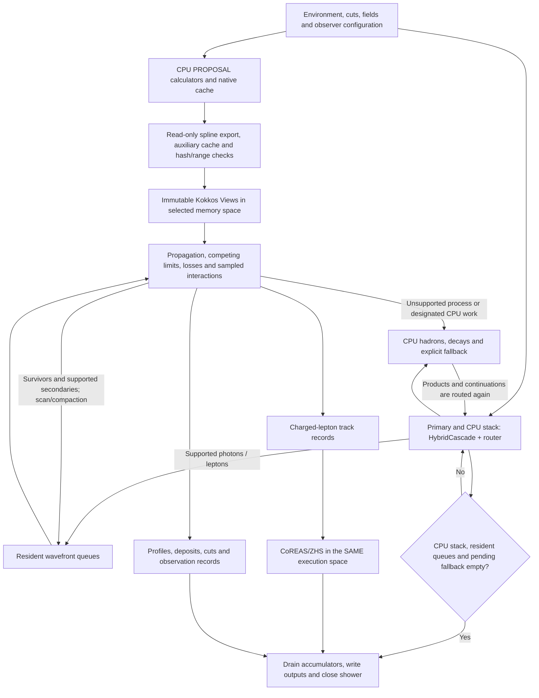

# CORSIKA8-kokkos

[中文安装与使用手册](README_CN.md)

**Use the [`CORSIKA8-kokkos` branch](https://github.com/BossL668/CORSIKA8-kokkos/tree/CORSIKA8-kokkos)
of the public [CORSIKA8-kokkos repository](https://github.com/BossL668/CORSIKA8-kokkos).**
This is the default GitHub branch and the current production source.

A standalone CORSIKA-based application for atmospheric particle showers and
CoREAS/ZHS radio signals. The same Kokkos electromagnetic-transport and radio
sources are compiled for multicore CPUs or supported GPUs. This is a research
branch, not an official CORSIKA release. Installation does not require an older
checkout, an existing build tree or manually prepared `.c8emrt` tables.

Latest changes (2026-10-20):

- Installation fixes: use versioned Miniforge installer/checksum assets; add
  RTX 50-series compute-capability 12.0 profiles (`BLACKWELL120`, CUDA 12.8+).
- Preserve Conan's backend and architecture selection when configuring with
  a toolchain file, so the build flags and installed manifest agree.
- Fix compilation of read-only particle adapters when stopped-positron
  annihilation is disabled; its default and all physics algorithms are unchanged.
- Clarify FLUKA checks and first CUDA-run diagnostics. See the
  [installation feedback and fixes](documentation/installation_feedback_20261020_CN.md).

Changes (2026-10-19):

- Optional **static CPU-parallel prefix**: `--prefix-workers N` advances
  independent CPU subshowers before handing their combined EM/muon frontier
  to the selected GPUs. The CPU process count is independent of the GPU count;
  both one-GPU and multi-GPU continuation are supported with `kokkos-proposal`.
  The default remains the serial prefix; no dynamic redistribution is added.
- `--prefix-split-energy` controls the CPU splitting threshold, not a physics
  cut. `C8_STATIC_FRONTIER_IMPORT_BATCH` optionally controls static GPU-root
  import chunks independently of `--gpu-min-batch`; unset retains the old rule.
- CPU handoff preserves particle species (including nuclei and hadrons), kinetic
  energy, weights, transport identity and logical environment ownership. CPU
  and GPU descendants use disjoint history ranges; signed radio fields and
  profiles include the bootstrap and every completed worker exactly once.
- The coordinator no longer reserves the large shower stack frame, and SHA256
  file reads use a heap buffer. Added handoff, namespace and small-stack tests.
  Physics models, CDF algorithms, cuts, thinning and stopped-positron defaults
  are unchanged. Parallel splitting changes subsequent random histories and
  may be slower for low-energy events; it is not enabled automatically.

See [prefix options and examples](documentation/native_multigpu_CN.md#静态-cpu-并行前缀2026-10-19).

Changes (2026-10-15):

- The air-shower Kokkos path now exports C8's environment-node hierarchy,
  including parent/child and excluded-node relations, and shares C8's ordered
  boundary-search logic. The observation plane remains a separate step limit.
- Curved sphere intersections use stable quartic factorization; the parallel-field
  transport projection is corrected. No per-step residual scan or bisection
  fallback is introduced. This does not promise bitwise-identical trajectories.
- Logical environment-node IDs survive device queues, CPU fallback and static
  multi-GPU handoff. Full-tree runs require the new V2 frontier format; regenerate
  older V1 frontiers before using them with this path.
- Extra two-photon emission from positrons removed at the energy cut is now
  **disabled by default**, matching original C8, on both scalar and shared Kokkos
  cut paths. **In-flight positron annihilation remains enabled.** Rebuild both
  CPU and GPU binaries; do not mix samples with different stopped-cut policies.
- The existing native-CDF policy is retained: photon pair production and muon
  bremsstrahlung use native-table inversion on the accelerated path; electron
  and muon direct electron-pair final states use CPU PROPOSAL because their
  conditional asymmetry tables are unavailable. No pair-splitting rejection
  sampler or experimental CDF-derivative/inverse-loss optimization is enabled.

Application interfaces retained from the previous release:

- The air application selects EM physics with `--em-backend proposal`,
  `kokkos-proposal` or `kokkos-egs4`; execution hardware is selected separately.
- Unified `--device`: one GPU ID selects a single-GPU shower; multiple IDs
  select native C++ multi-GPU coordination for the same shower.
- The optional C++/Kokkos EGS4 backend is a regular CORSIKA module, with its
  AIR-NTP table bundled and embedded at build time. No external C7 installation
  or runtime table-path argument is required.
- Application bindings and run sessions encapsulate backend setup and reuse;
  the main air-shower application remains the entry point for both EM backends.

Tiny-batch CPU fallback and tail-repartitioning experiments are not production
defaults. Module-level speedups must not be interpreted as whole-shower speedups.

Air application update (2026-09-23): `c8_air_shower` now defaults to
`--profile-crossings original-c8` (forward crossings, closed endpoints).
`forward` selects forward half-open counts; `both` selects positive weighted
crossings in either direction. CPU writers and Kokkos CUDA/OpenMP share the
policy; transport, radio tracks, cuts and deposited energy are unchanged.
Rebuild and reinstall; do not mix profile cohorts using different conventions.
See [counting semantics and runnable examples](documentation/profile_crossings_CN.md).

Historical note (2026-09-20): an additional stopped-positron two-photon model
was introduced at the energy cut. Its implementation is retained, but the
2026-10-15 default disables it to match original C8. The
[original implementation note](documentation/stopped_positron_annihilation_20260920_CN.md)
describes the earlier enabled policy, not the current default.

This guide starts with **Ubuntu 24.04 x86-64, Bash and an empty Conda environment**.
After the common setup, choose an independent backend or the new single-binary
experiment. OpenMP is the simplest CPU-only starting point; NVIDIA users can
proceed directly to section 8.1 for the independent CUDA executable. HIP/SYCL setup is
described separately and still needs target-hardware acceptance.

### Reading order

1. [Capabilities and architecture](#1-what-the-program-does).
2. [Empty environment](#3-prepare-an-empty-development-environment),
   [source and dependencies](#4-obtain-complete-source-and-configure-conan),
   [licensed physics models](#5-prepare-physics-models): common to every build.
3. [OpenMP build](#6-build-openmp-first-no-gpu-required) and
   [first shower](#7-run-the-first-complete-example), or
   [NVIDIA and combined builds](#8-add-nvidia-cuda).
4. [Run options](#9-minimal-commands-and-important-parameters),
   [HIP/SYCL](#10-hipsycl-on-matching-hardware),
   [tests and troubleshooting](#11-tests-updates-and-troubleshooting).
5. Optional: [EGS4 backend](#94-optional-ckokkos-egs4-backend),
   [terrain setup and first run](documentation/terrain_getting_started.md),
   [documentation map and validation status](documentation/USER_GUIDE_INDEX.md).

Commands without a shell prompt can be copied. Follow one backend route, not all
routes at once. Shell variables shown below are examples; no developer's local
directory or previous installation is required. Dated validation notes describe
their recorded revision; they do not replace this installation guide.

## 1. What the program does

- Kokkos transport of photons, electrons, positrons and supported muons,
  including propagation, losses, interactions, cuts, thinning and profiles.
- CoREAS/ZHS radio accumulation in the same execution backend as accelerated EM.
- Read-only export of PROPOSAL native splines, automatic auxiliary caches,
  double precision and version/medium/cut/energy-range/hash checks.
- Optional C7-derived EGS4 algorithms rewritten in C++/Kokkos for electrons,
  positrons and photons, retaining C8's existing hadronic and muon modules.
  This is not a wrapper around the C7 Fortran executable.
- Existing CPU hadronic models, decays and explicit unsupported-process
  fallbacks; a scalar PROPOSAL reference mode remains available.

The scientific build below uses SIBYLL-2.3d and separately licensed FLUKA.
Not every CORSIKA process runs on the GPU. Production single-endpoint modes use
OpenMP **or** a GPU. The combined build additionally offers explicit experimental
air-shower cooperation (section 9). CUDA and CUDA/OpenMP builds also provide native
single-shower multi-GPU coordination through `c8_air_shower --device 0,1,2,3`.
See [native multi-GPU usage](documentation/native_multigpu_CN.md); Python is not
used by that execution path.

## 2. Choose a build: portable installations or a single CUDA/OpenMP binary

### 2.1 Two deployment options, the same physics sources

| Need | Build helper | How to select execution |
|---|---|---|
| CPU-only server | `build_kokkos.sh openmp` | Launcher: `--backend openmp` |
| Portable CPU/GPU installations | `build_kokkos.sh openmp,cuda` (HIP/SYCL separately) | Launcher selects one installed executable |
| One executable containing CUDA **and** OpenMP | `build_kokkos_dual.sh` | Direct executable: `--kokkos-execution cuda\|openmp` |

Independent installations remain the production/deployment baseline. The new
single-executable option is an experiment for a machine with a working NVIDIA
device; it is not a universal CPU/NVIDIA/AMD/Intel executable.



Backend specialization happens at compile time. The launcher selects an
installed executable; it does not compile physics code at startup or schedule
individual particles. CPU and GPU variants may coexist on disk. Each independent
GPU binary uses a Kokkos Serial host backend, while the OpenMP binary requires no
GPU runtime. This is this project's deployment choice, not a universal Kokkos
restriction.

An **experimental single CUDA/OpenMP executable** is also available through
`tools/build_kokkos_dual.sh`. It selects one execution space at startup using
`--kokkos-execution cuda|openmp`; these two selections do not run both instances
concurrently. Explicit `cuda-openmp` and `openmp-cuda` instead select the
air-shower cooperation experiments described in section 9. Unlike the
independent OpenMP build, the combined executable currently requires a
working NVIDIA device/driver even in OpenMP mode. It installs separately under
`install/cuda-openmp` and is not selected by the normal launcher. Section 8.2
below provides the complete build/run steps after environment setup. See the
[dual-backend experiment](documentation/cuda_em_refactor/beta5_dual_cuda_openmp_experiment_CN.md)
for the detailed validation record and limitations.

### 2.2 Directory layout

New installations below use `~/corsika8-workspace/CORSIKA8-kokkos` for the
source, with sibling `build/` and `install/` directories. Existing checkouts
can keep their current paths; do not move configured CMake build trees.

```text
corsika8-workspace/
├── CORSIKA8-kokkos/            source, recipes, examples, docs and tests
├── build/
│   ├── openmp/deps/            OpenMP build and Conan/CMake descriptors
│   ├── cuda/deps/              separate CUDA equivalents
│   ├── cuda-openmp/deps/       combined experiment's own dependency graph
│   └── ...                    HIP/SYCL or audit records
└── install/
    ├── bin/c8_air_shower       common Python launcher
    ├── openmp/                binaries, libraries, model data and manifest
    ├── cuda/                  GPU equivalents; HIP/SYCL added as needed
    └── cuda-openmp/           optional single-binary experiment, separate prefix
```

`deps` contains dependency locations and compiler settings, not another source
project or physics tables. Actual Conan packages live in the user cache.
Configured CMake trees contain absolute paths: do not copy their caches between
backends or machines. All variants use the same application source.

Example paths such as `examples/beta5/`, CTest names containing `Beta5`, and
dated report filenames retain their existing identifiers for compatibility.
Use those paths and names literally; they do not select an older release.

### 2.3 Algorithm: resident wavefront transport and online radio accumulation

The following is the **Kokkos PROPOSAL** path. Scalar `proposal/cpu` keeps the
original serial Cascade/PROPOSAL route. The arrows describe data ownership and
dependencies, not simultaneous CPU/GPU execution. The optional EGS4 module uses
the same application and common run settings; see section 9.4.



1. **Prepare once, reuse per process.** PROPOSAL remains the physics provider.
   Exported native splines, environment data and auxiliary distributions are
   placed in the selected execution space; a new shower resets event state
   through `beginShower()` while reusing compatible tables/workspaces.
2. **Advance a front, not only a final state.** Particle batches undergo
   propagation, geometry/observation checks, continuous losses, discrete
   interactions, scattering, cuts and thinning. Survivors and supported
   secondaries continue in resident queues; they do not return to the host
   individually after every reaction. Explicit fallback/checkpoints remain.
3. **One source, compile-time execution-space specialization.** Kokkos Views,
   kernels and scan/compaction run in OpenMP HostSpace or the chosen GPU memory
   space. History-keyed Philox draws do not depend on thread completion order;
   this does not promise identical shower trees across hardware.
4. **CPU work is not discarded.** Hadronic products, decays and unsupported
   accelerated processes are handled explicitly on the CPU and routed again.
   EM/radio acceleration is not multi-threaded hadronic model execution.
5. **Radio is accumulated during transport in batches**, rather than waiting
   for the full shower tree. Track precomputation and observer tiling amortize
   projection work; OpenMP uses host blocking/thread-local accumulation, while
   GPUs use device policies. Checked fixed-point accumulation preserves the
   existing determinism/overflow checks. Final waveform download/writing occurs
   after all pending work is drained. Window completeness still needs validation.

The air-shower `kokkos-proposal` path exports the C8 environment tree at
initialization, including parent/child links, excluded nodes and exact supported
medium parameters. Native C8 and the exported tree use the same ordered
boundary-search routine; the observation plane remains a separate step limit.
Logical node IDs are retained across wavefront queues, CPU fallback and static
multi-GPU handoff, rather than reconstructed from rounded boundary positions.
Curved sphere intersections use a stable quartic solver, without a per-step
residual scan or bisection fallback. See
[environment regression tests](validation/accelerator/environment_tree/README.md)
for supported shapes, validation and compatibility limits.

Where this logic lives:

| Responsibility | Source |
|---|---|
| Models, CLI and output lifecycle | [c8_air_shower.cpp](applications/c8_air_shower.cpp) |
| Encapsulated air-shower adapter and grouped bindings | [KokkosAirShowerApplication.hpp](applications/detail/air_shower_kokkos/KokkosAirShowerApplication.hpp), [KokkosAirShowerBindings.hpp](applications/detail/air_shower_kokkos/KokkosAirShowerBindings.hpp) |
| Application session lifecycle | [KokkosRunSession.hpp](applications/detail/air_shower_kokkos/KokkosRunSession.hpp) |
| Session, native export and reuse | [KokkosEmRunSession.hpp](corsika/accelerator/em/detail/KokkosEmRunSession.hpp) |
| CPU / accelerated particle routing | [PhysicalAcceleratedEmRouter.hpp](corsika/accelerator/em/PhysicalAcceleratedEmRouter.hpp) |
| Host-side instance selection | [KokkosEmBackend.cpp](src/accelerator/em/kokkos/KokkosEmBackend.cpp) |
| Shared instantiated implementation | [KokkosBackendInstance.inl](src/accelerator/em/kokkos/KokkosBackendInstance.inl) |
| Photon/lepton transport and native tables | [Kokkos EM templates](corsika/accelerator/em/kokkos) |
| CoREAS/ZHS projection and accumulation | [KokkosRadioAccumulator.hpp](corsika/accelerator/radio/kokkos/KokkosRadioAccumulator.hpp) |
| Optional EGS4 public API, implementation and compiled sources | [EGS4.hpp](corsika/modules/EGS4.hpp), [API](corsika/modules/egs4/), [implementation](corsika/detail/modules/egs4/), [sources](src/modules/egs4/) |
| Native single-shower multi-GPU coordination | [air_shower_multigpu](applications/detail/air_shower_multigpu/) |

The dual build compiles `KokkosCudaBackendInstance.cpp` and
`KokkosOpenMPBackendInstance.cpp` against that same implementation, then links
both into one program. Selection/virtual dispatch is at host batch boundaries;
per-particle kernels remain statically specialized templates.

## 3. Prepare an empty development environment

You need a writable user directory, dependency-download access, and compatible
C++17/Fortran compilers. As a planning allowance, reserve 30–50 GiB for source,
dependencies and builds, with additional space for CUDA, other backends and
simulation output. This is not a measured minimum. Start with one build job.
On WSL, `free -h` shows the Linux allocation, not necessarily all physical RAM.

### 3.1 Install host tools

On Ubuntu, an administrator can install the following; this installs no GPU driver:

```bash
sudo apt-get update
sudo apt-get install -y build-essential gfortran git curl ca-certificates \
  pkg-config autoconf automake libtool bison flex patch unzip bzip2 xz-utils file
```

Without sudo, ask the administrator for these tools or load the server's
compiler modules. This guide uses system GCC/G++/GFortran consistently; do not
also add a different Conda C++ toolchain. Other distributions require their own
package-manager instructions. Never replace a shared server's driver yourself.

### 3.2 Install Conda, if absent

Existing Miniconda/Anaconda users can skip this step. These Miniforge commands
are for Linux x86-64, and the installation prefix must not already exist.
See the [official Miniforge instructions](https://github.com/conda-forge/miniforge#install).

```bash
mkdir -p "$HOME/Downloads"
cd "$HOME/Downloads"
c8_miniforge_version=26.7.2-0
c8_miniforge_asset="Miniforge3-${c8_miniforge_version}-Linux-x86_64.sh"
curl -fLO "https://github.com/conda-forge/miniforge/releases/download/${c8_miniforge_version}/${c8_miniforge_asset}"
curl -fLO "https://github.com/conda-forge/miniforge/releases/download/${c8_miniforge_version}/${c8_miniforge_asset}.sha256"
sha256sum -c "${c8_miniforge_asset}.sha256"
# Continue only after a successful checksum check:
bash "${c8_miniforge_asset}" -b -p "$HOME/miniforge3"
source "$HOME/miniforge3/etc/profile.d/conda.sh"
```

The installer and checksum must name the **same release asset**. The unversioned
installer alias does not necessarily have an unversioned `.sha256` companion;
do not bypass checksum verification after a 404.

### 3.3 Create and verify the environment

These tool/particle-database versions have been used by the project. No
pre-existing `corsika_venv` is assumed:

```bash
conda create -n corsika_venv --override-channels -c conda-forge \
  python=3.11 pip cmake=3.31 ninja numpy=1.26.4 pyyaml lxml
conda activate corsika_venv
python -m pip install "conan==2.11.0" "particle==0.25.1" "hepunits==2.4.1"
export CC=/usr/bin/gcc
export CXX=/usr/bin/g++
export FC=/usr/bin/gfortran

python -c 'import particle, hepunits, numpy, yaml; print("Python dependencies OK")'
cmake --version
conan --version
gcc --version
g++ --version
gfortran --version
```

`particle` and `hepunits` generate particle-property code **during compilation**;
they are not optional plotting dependencies. Their versions affect the particle
database and should be recorded. For later Parquet analysis/plotting, optionally
install `pandas pyarrow scipy matplotlib`.

Do not overwrite an existing environment of the same name. Inspect it or use
a different name. In every new terminal, source the actual Conda installation's
`etc/profile.d/conda.sh` and activate `corsika_venv` before building or running.

## 4. Obtain complete source and configure Conan

The source is on the `CORSIKA8-kokkos` branch of the
[public project repository](https://github.com/BossL668/CORSIKA8-kokkos/tree/CORSIKA8-kokkos).
Read-only HTTPS cloning does not require GitHub authentication. Older branches
remain separate; the default branch is `CORSIKA8-kokkos`.
The public repository does not remove third-party model licensing requirements.

For SSH, use `git@github.com:BossL668/CORSIKA8-kokkos.git` with a configured
GitHub SSH key. Pushing changes requires authentication and write permission;
never put a token in a URL, script or README.

```bash
mkdir -p "$HOME/corsika8-workspace"
cd "$HOME/corsika8-workspace"
git clone --branch CORSIKA8-kokkos --single-branch --recurse-submodules \
  https://github.com/BossL668/CORSIKA8-kokkos.git CORSIKA8-kokkos
cd CORSIKA8-kokkos
test -f CMakeLists.txt
test -f conanfile.py
test -f modules/data/CMakeLists.txt
test -f resources/GeoMag/IGRF14.COF
git submodule status --recursive
```

If the clone already exists, first inspect `git status` and
`git branch --show-current`; do not clone over it. Missing submodules can be
initialized with `git submodule update --init --recursive`. A leading `-` in
submodule status indicates an uninitialized module; a leading `+` means it does
not match the revision pinned by this checkout.

The model data and optional CONEX source are pinned upstream submodules, not
large files duplicated in this repository. Their absolute URLs also work
when cloning from GitHub. GitHub's automatic source ZIP does **not** include
submodule contents. If receiving an offline archive instead, ask for a complete
archive including both submodules, recipes, resources and examples. Local
build/install directories, generated caches and simulation datasets are not
part of the source repository.

Conan manages C++ dependencies; CMake configures the application. With the
previous environment and compiler selections still active, from the source directory:

```bash
conan profile detect
conan profile show -pr:h default -pr:b default
conan remote list
conan export third_party/conan/cubicinterpolation
conan export third_party/conan/proposal
conan export dependencies/kokkos
```

Inspect the profile: GCC major version must match `g++ --version`, C++17
(`gnu17` is acceptable), and `libstdc++11`. Detection is a starting point,
not a verified configuration. Do not force-overwrite an existing default
profile. Archive profiles and dependency lockfiles for production reproduction.
See the [Conan profile documentation](https://docs.conan.io/2/reference/commands/profile.html).

ConanCenter should be enabled; **only if no remote exists**, add it:

```bash
conan remote add conancenter https://center2.conan.io
```

`conan export` registers recipes, not compiled libraries. The build helper later
builds missing packages. Required references are `kokkos/4.7.03@c8gpu/stable`,
`proposal/7.6.2@c8gpu/stable` and `cubicinterpolation/0.1.5@c8gpu/stable`.
The latter two provide patched read-only spline exports. Do not mix vanilla
headers, patched libraries or old object files. Transitive dependencies also
matter for reproducing the full binary graph.

## 5. Prepare physics models

### Scientific configuration: SIBYLL and FLUKA

FLUKA has a separate license and is not distributed with this source or via
Conan. Obtain the authorized package appropriate to the system/Fortran compiler
and follow the [official installation guide](https://fluka.cern/documentation/installation).
Keep its runtime data, not just a copied static library. If installed in `~/fluka`:

```bash
export FLUPRO="$HOME/fluka"
test -r "$FLUPRO/libflukahp.a"
test -x "$FLUPRO/flutil/lfluka"
cat "$FLUPRO/Version.tag"
cat "$FLUPRO/makeflags"
file "$FLUPRO/flukahp"
ldd "$FLUPRO/flukahp"
```

For a compatible 64-bit Linux/GFortran package with `lfluka`, also check linking
in a temporary directory. Explicitly select the compiler used in this guide
instead of relying on the package's compiler autodetection (no simulation runs):

```bash
c8_fluka_check=$(mktemp -d)
(cd "$c8_fluka_check" && FLUFOR=gfortran GFORFLU=/usr/bin/gfortran FLUARCH=64 \
  "$FLUPRO/flutil/lfluka" -o fluka_link_check \
  && ldd ./fluka_link_check)
```

Use the Linux package compatible with your Fortran compiler; a Windows package
is not a WSL Linux library. Resolve any `not found` dependencies above. CMake
must print `FLUKA support is enabled.`; `WITH_FLUKA=ON` alone is not proof that
it found the library. If necessary, append
`-DC8_FLUKALIB="$FLUPRO/libflukahp.a"` to the build command, keeping `FLUPRO`
set for runtime data. Record both `Version.tag` and the version reported by
the linked library; a mismatch needs checking against that installation, not
hard-coding a different version string.

Fix installation/path problems before continuing.
SIBYLL-2.3d source is included. By default, CMake downloads and builds pinned
Pythia 8.315 and TAUOLA 1.1.8 sources. **A fresh environment does not need an
existing `build/external` or another machine's model paths.** Initial builds
need ConanCenter, GitHub, Pythia's GitLab and CERN download access.

### Learning without a FLUKA license

For an installation exercise only, explicitly use `-DWITH_FLUKA=OFF` below.
The low-energy model then becomes UrQMD. It is not the SIBYLL+FLUKA configuration
and must not be pooled into that validation ensemble. Model replacement is not
merely a compilation or performance choice.

## 6. Build OpenMP first: no GPU required

In the source directory, with the environment active and FLUPRO checked:

```bash
C8_BUILD_JOBS=1 bash tools/build_kokkos.sh openmp -DWITH_FLUKA=ON
```

The helper performs:

```text
conan install --build=missing
    -> build/openmp/deps/conan_toolchain.cmake
    -> CMake Release configuration
    -> compile models, application and tests
    -> install/openmp plus the common install/bin/c8_air_shower launcher
```

Initial dependency downloads/builds can take much longer than running a shower.
`C8_BUILD_JOBS=1` limits compiler and Conan build concurrency, not simulation
threads. Increase to two or four only with sufficient memory; do not start with
`-j128`. The helper stops on errors. Read the first error, not just the final
failure message; an existing build directory does not imply installation success.

Return to the project container directory and check the installation:

```bash
cd ..
install/bin/c8_air_shower --list-backends
install/bin/c8_air_shower --backend openmp --check-backends
install/bin/c8_air_shower --backend openmp -- --help
```

Expect OpenMP `installed: true`, then probe `available: true`, `gpu=false` and
`openmp=true`. Listing reads metadata; a probe checks primitives, not full physics.

## 7. Run the first complete example

From the project container directory, use the three demonstration antennas
provided with the source; no private dataset is required:

```bash
mkdir -p "$HOME/CorsikaData"
install/bin/c8_air_shower --backend openmp --kokkos-num-threads 4 \
  -p 22 -E 10 -s 12345 -f "$HOME/CorsikaData/first_photon_openmp" \
  --antenna-file CORSIKA8-kokkos/examples/beta5/antennas_minimal_nwu.txt
```

This runs one vertical 10 GeV photon shower, with Kokkos EM and both Kokkos
radio algorithms enabled by the launcher. **The final `-f` directory must not
already exist.** Create only its parent; use a new output name for a repeat.
Low-energy signals may be weak or absent at some observers. This example checks
installation, not GPU saturation or radio-distribution agreement.

Antenna rows contain `north_m west_m up_m`, with `#` comments allowed. The air
application places the third coordinate at `EarthRadius + up_m`: it is height
above the reference Earth radius, **not height above local ground**. The example
uses the default observation height, 2680.444195 m. Without valid antenna rows
and with `--ring 0`, there may be no radio observers; exit success alone does
not demonstrate that radio output was tested.

On first use, PROPOSAL may create its own cache before exporting native splines.
Auxiliary caches default to `~/.cache/corsika8/gpu-em-aux` or the XDG location.
PROPOSAL's own cache uses `corsika_data("PROPOSAL")`; its data directory needs
write access. `--gpu-aux-cache-dir` changes only auxiliary-cache placement.
No manual table preparation does not mean no interpolation/cache, nor automatic
support for arbitrary geometry or media.

Inspect `profile/`, `energyloss/`, `particles/`, `CoREAS/`, `ZHS/`, `gpu_em/`
and `simulation_timing/`, including their shower subdirectories. Check errors,
completion summaries and Parquet readability before launching larger campaigns.
Equal seeds do not guarantee bitwise-identical CPU/OpenMP/GPU shower trees;
process-level and ensemble acceptance are separate requirements.

| Output family | What to check |
|---|---|
| `profile`, `particles` | Longitudinal components and observation-particle records; inspect Parquet schema and shower IDs |
| `energyloss` | Check individual categories: total bookkeeping can include cut/invisible energy, not just calorimetric deposition |
| `CoREAS`, `ZHS` | Observer positions, time axis, units and edge samples before interpreting a pulse |
| `gpu_em` | Actual execution space, native-table identity, transport/fallback counters and completion |
| `simulation_timing` | Timing scope and event identity; do not mix kernel-only and wall-clock measurements |

For a first readable-data check (optional analysis packages):

```bash
python -m pip install pandas pyarrow scipy matplotlib
python - <<'PY'
from pathlib import Path
import pyarrow.parquet as pq
root = Path.home() / "CorsikaData/first_photon_openmp"
files = sorted(root.rglob("*.parquet"))
assert files, "No Parquet files: inspect the run log and output path"
for path in files:
    data = pq.ParquetFile(path)
    print(path.relative_to(root), data.metadata.num_rows, data.schema.names)
PY
```

This reads file metadata, not a whole shower into memory. Empty tables can be
physical at low energy. Readability alone does not establish physical acceptance.

## 8. Add NVIDIA CUDA

**Only execute this section where GPU use is permitted.** CPU-only users can stop
at the preceding section. A driver exposes the GPU; the Toolkit supplies `nvcc`
and development libraries. The CUDA version printed by `nvidia-smi` is not the
installed compiler version. Administrators manage drivers. WSL2 uses the Windows
NVIDIA driver; do not install a Linux display driver inside WSL.
See [NVIDIA's WSL guide](https://docs.nvidia.com/cuda/wsl-user-guide/index.html).

Skip Toolkit installation if a compatible one already exists. For pre-Blackwell
GPUs, CUDA 12.6.3 can be installed in Conda. This example
pairs with Ubuntu 24.04's GCC 13 family; check other combinations against the
[CUDA 12.6 compiler/install guide](https://docs.nvidia.com/cuda/archive/12.6.3/cuda-installation-guide-linux/index.html).

```bash
conda activate corsika_venv
conda install --override-channels -c nvidia/label/cuda-12.6.3 -c conda-forge cuda
nvcc --version
nvidia-smi
```

For an **RTX 50-series GPU with compute capability 12.0** (for example RTX 5070),
use **CUDA 12.8 or newer**, not the 12.6 example. One reported working setup uses
Ubuntu 24.04 / WSL2, system GCC 13, CUDA 12.8.1 and Kokkos 4.7.03:

```bash
conda install --override-channels -c nvidia/label/cuda-12.8.1 -c conda-forge cuda
nvcc --version
nvidia-smi --query-gpu=name,compute_cap --format=csv,noheader
```

See [NVIDIA's CUDA 12.8 release notes](https://docs.nvidia.com/cuda/archive/12.8.0/cuda-toolkit-release-notes/index.html).
This is a standalone-CUDA installation smoke check, not validation of every
Blackwell model or of the experimental CUDA/OpenMP combined executable.

This installs developer tools, not a repaired system driver. The old runtime-only
`cudatoolkit` package is not a substitute for `nvcc`. With a system Toolkit, put
its `bin` on PATH; do not mix headers, compilers and libraries from different
Toolkit installations.

### 8.1 Independent CUDA executable (production baseline)

```bash
cd "$HOME/corsika8-workspace/CORSIKA8-kokkos"
export CC=/usr/bin/gcc
export CXX=/usr/bin/g++
export FC=/usr/bin/gfortran
C8_BUILD_JOBS=1 bash tools/build_kokkos.sh cuda -DWITH_FLUKA=ON
```

The helper queries compute capability with `nvidia-smi` and selects a profile:

| Example target | Profile | CUDA architecture |
|---|---|---|
| Turing | `cuda-turing75` | 75 |
| A100 | `cuda-ampere80` | 80 |
| Ampere 8.6 | `cuda-ampere86` | 86 |
| RTX 4060 / Ada 8.9 | `cuda-ada89` | 89 |
| H100 | `cuda-hopper90` | 90 |
| RTX 50-series / Blackwell 12.0 | `cuda-blackwell120` | 120 (CUDA 12.8+) |

`BLACKWELL120` does not mean all Blackwell GPUs; compute capability 10.0 is a
different target. Unknown/mixed architectures are not guessed. A known target can be explicit:

```bash
C8_KOKKOS_PROFILE=cuda-ampere80 C8_BUILD_JOBS=1 \
  bash tools/build_kokkos.sh cuda -DWITH_FLUKA=ON
```

This bypasses architecture discovery, not driver validation.
`CORSIKA_ENABLE_CUDA=ON` is not a supported build option; select Kokkos CUDA instead.
`bash tools/build_kokkos.sh openmp,cuda -DWITH_FLUKA=ON` builds both sequentially.

After installation, from the project container directory:

```bash
cd ..
install/bin/c8_air_shower --backend cuda --check-backends
set -o pipefail
install/bin/c8_air_shower --backend cuda \
  -p 22 -E 10 -s 12345 -f "$HOME/CorsikaData/first_photon_cuda" \
  --antenna-file CORSIKA8-kokkos/examples/beta5/antennas_minimal_nwu.txt \
  2>&1 | tee first_photon_cuda.log
```

Both commands access the GPU. Do not request multiple Kokkos host threads in
GPU mode. The default memory budget is a ceiling of 70% of available device
memory at initialization, not a requirement to fill it with a small shower.

Check the executable's exit status, event completion/output and the CUDA EM
summary's processed photon/lepton steps. `--check-backends` checks availability;
it does not prove that a shower used the device. The manifest's
`host_execution: serial` describes the host execution space of a CUDA build,
not a switch disabling CUDA. Its `architecture` must match the selected profile
(for example `BLACKWELL120`, not `NONE`).

A missing optional tuning file uses defaults. A low-energy thinning warning
does not by itself mean failure. `energy_ledger.complete_coverage: false`
(or `complete=false` in a summary) means the diagnostic does not account for
all paths, so its residual is not a complete energy-conservation test.
Zero `kernel`/`transfer` timing fields are also not sufficient to infer no GPU
work; inspect the step counters and backend wall time. Successful installation
and readable output are not substitutes for statistical physics acceptance.

### 8.2 New option: build CUDA and OpenMP into one executable

Complete sections 3–5 and the CUDA Toolkit setup above first. You do **not**
need to build the independent OpenMP/CUDA applications before this experiment.
From the source directory, with the same environment and licensed FLUPRO:

```bash
cd "$HOME/corsika8-workspace/CORSIKA8-kokkos"
conda activate corsika_venv
test -f tools/build_kokkos_dual.sh
test -r "$FLUPRO/libflukahp.a"
nvcc --version
nvidia-smi
C8_BUILD_JOBS=1 bash tools/build_kokkos_dual.sh -DWITH_FLUKA=ON
```

If the script is absent, obtain a source revision containing the dual-backend
experiment. Do not substitute `build_kokkos.sh openmp,cuda`: that builds **two**
independent executables. The dual helper installs its own dependency graph,
configures `CORSIKA_KOKKOS_BACKEND=CUDA_OPENMP`, compiles both EM/radio instances
and all configured build products before the global install, then installs to
`../install/cuda-openmp`; independent installs are not overwritten. Like the
independent helper, it can also compile tests and optional interface libraries.

**The combined script now detects the GPU architecture automatically.** It queries
`nvidia-smi` and selects a bundled combined profile for capabilities 7.5
(Turing/RTX 20), 8.0 (A100), 8.6 (RTX 30), 8.9 (Ada/RTX 40 and L20),
9.0 (H100), or 12.0 (RTX 50, CUDA 12.8+). The Blackwell combined profile still
needs target-hardware regression; the independent-CUDA installation report
does not validate this combined mode. To inspect the target:

```bash
nvidia-smi --query-gpu=compute_cap --format=csv,noheader
```

If mixed GPU architectures are visible or detection is unavailable, the
script stops instead of guessing. Explicitly select the intended bundled
combined profile, for example A100:

```bash
C8_KOKKOS_DUAL_PROFILE="$PWD/dependencies/kokkos/profiles/cuda-openmp-ampere80" \
  C8_BUILD_JOBS=1 bash tools/build_kokkos_dual.sh -DWITH_FLUKA=ON
```

The independent CUDA script also auto-detects, but its override variable is
`C8_KOKKOS_PROFILE`. Rebuild with a fresh CMake cache when changing GPU
architecture.

The air-shower application's `--em-backend` names are:

| Value | Transport path |
| --- | --- |
| `proposal` | Original scalar CPU PROPOSAL (direct application's default) |
| `kokkos-proposal` | Kokkos PROPOSAL; formerly `kokkos` |
| `kokkos-egs4` | Kokkos EGS4; formerly `egs4`, requires EGS4 enabled at build time |

Only the EM selector names changed. `--kokkos-execution`, `--device`,
`--kokkos-num-threads`, `--radio-backend cpu|kokkos` and all physics defaults
are unchanged. Update old EM names in scripts when using the rebuilt binary;
do not mix a new launcher/coordinator with an old worker executable.
For EGS4 build flags, embedded tables and examples, see section 9.4.

After a successful build, these commands use the **same binary**, from the
project container directory. No private antenna file is needed:

```bash
cd ..
export CORSIKA_DATA="$PWD/install/cuda-openmp/share/corsika/data"
install/cuda-openmp/bin/kokkos_backend_probe --backend cuda --threads 1
install/cuda-openmp/bin/kokkos_backend_probe --backend openmp --threads 4
mkdir -p "$HOME/CorsikaData"

install/cuda-openmp/bin/c8_air_shower \
  --em-backend kokkos-proposal --radio-backend kokkos --kokkos-execution cuda \
  -p 22 -E 10 -s 12345 -f "$HOME/CorsikaData/dual_photon_cuda" \
  --antenna-file CORSIKA8-kokkos/examples/beta5/antennas_minimal_nwu.txt

install/cuda-openmp/bin/c8_air_shower \
  --em-backend kokkos-proposal --radio-backend kokkos --kokkos-execution openmp \
  --kokkos-num-threads 4 \
  -p 22 -E 10 -s 12345 -f "$HOME/CorsikaData/dual_photon_openmp" \
  --antenna-file CORSIKA8-kokkos/examples/beta5/antennas_minimal_nwu.txt
```

The direct application retains scalar defaults, so keep both `--em-backend
kokkos-proposal` and `--radio-backend kokkos`. This PROPOSAL acceleration path
uses `proposal-native` physics. Omitting `--kokkos-execution` in the combined build
selects CUDA **only when accelerated mode is requested**. Do not pass the
launcher's `--backend` to the application; the separate **probe** has its own
`--backend` option, as shown above.

- The combined program links/initializes CUDA even for OpenMP execution. A
  working visible NVIDIA device is required; hiding all GPUs is not a CPU-only
  deployment solution. Use `install/openmp` for that use case.
- A process chooses one execution space for EM **and** radio. It does not switch
  between showers in `-N N` or run OpenMP EM together with GPU radio. CUDA mode
  limits the compiled OpenMP host runtime to one thread; do not request 16.
- The common launcher does not register `cuda-openmp`; call this executable
  directly. HIP/SYCL remain independent target-specific builds, not members of
  this experimental executable.
- Release install, primitive/runtime gates and short `-N 2` photon/proton
  regressions passed locally against the corresponding independent backends.
  This is not a 500-event acceptance or a demonstrated speedup of the combined
  executable. See the [test record](documentation/cuda_em_refactor/beta5_dual_cuda_openmp_experiment_CN.md).

## 9. Minimal commands and important parameters

### 9.1 Optional cooperative air execution

Only the combined executable with `kokkos-proposal` accepts `cuda-openmp` (GPU-primary) and
`openmp-cuda` (CPU-primary). Both endpoints use shared EM/radio physics with
independent subshower queues; the coordinator owns scalar fallback and final
checked profile/radio merging. This is not hadronic parallelism and is not the
terrain scheduler. It is opt-in, not a default or a guaranteed speed-up.

After sections 3–5 and 8.2, from the project container directory:

```bash
install/cuda-openmp/bin/c8_air_shower \
  --em-backend kokkos-proposal --radio-backend kokkos \
  --kokkos-execution cuda-openmp --kokkos-num-threads 4 \
  -p 2212 -E 1000 -s 12345 -f "$HOME/CorsikaData/proton_cooperative" \
  --antenna-file CORSIKA8-kokkos/examples/beta5/antennas_minimal_nwu.txt
```

For CPU-primary scheduling replace only `cuda-openmp` with `openmp-cuda` and
choose a new output directory. Keep `--hadronic-workers` at its default 1.
Use only allocated CPU threads and a working NVIDIA device. CPU-primary cannot
be combined with `--kokkos-cooperative-policy adaptive`. Small pilots do not
measure high-energy performance; test matched physics settings and time scopes
on the actual hardware before choosing a policy.

The [independent-queue record](documentation/cuda_em_refactor/beta5_independent_subshower_queues_CN.md)
and [CPU-priority pilot](documentation/cuda_em_refactor/beta5_priority_endpoints_v2_simple_20260912_CN.md)
describe specific revisions/hardware. Neither a successful compile nor an older
pilot establishes present-day performance or statistical acceptance after a
physics fix. Dynamic scheduling does not promise an identical tree for equal seeds.

### 9.2 Single-endpoint and scalar reference commands

From the project container directory:

```bash
install/bin/c8_air_shower --backend cuda -p 2212 -E 1000 \
  -f "$HOME/CorsikaData/proton_1TeV_cuda" \
  --antenna-file CORSIKA8-kokkos/examples/beta5/antennas_minimal_nwu.txt
```

Replace `--backend cuda` with `--backend openmp --kokkos-num-threads 16` for
multicore CPU execution, keeping the physics parameters. For scalar reference:

```bash
install/bin/c8_air_shower --backend openmp \
  --em-backend proposal --radio-backend cpu \
  -p 2212 -E 1000 -s 12345 -f "$HOME/CorsikaData/proton_1TeV_scalar" \
  --antenna-file CORSIKA8-kokkos/examples/beta5/antennas_minimal_nwu.txt
```

Here the OpenMP installation supplies the executable, but `proposal/cpu` does
not run accelerated EM. Direct `install/<backend>/bin/c8_air_shower` executables
also retain scalar defaults; only the launcher adds Kokkos EM/radio defaults.
For `kokkos-proposal`, the physics source is `proposal-native`; no additional
physics-source selector, medium YAML or `.c8emrt` file is needed.
For the optional `kokkos-egs4` path, see section 9.4.

**Local development only — cached loss (not in the published branch as of
2026-10-08):** after building the candidate code and its tests, append
`--kokkos-loss-solver cached` to a `kokkos-proposal` OpenMP, CUDA or native
multi-GPU `--device` air-shower command. A fresh public checkout does not yet
provide this option.
The default remains `original`. This only reuses query-local endpoint and spline
evaluations; no midpoint approximation, new tolerance or transport step is introduced.
Native scalar PROPOSAL, the multi-GPU scalar prefix and CPU fallbacks are unchanged.
The choice is recorded in the run outputs. Do not mix old headers/static libraries
with the rebuilt application. Local regression details are in the Chinese guide;
full four-L20 production/performance acceptance remains a separate step.

| Parameter | Meaning / default |
|---|---|
| `--backend openmp/cuda/hip/sycl` | Launcher only: installed executable to select; omitted means `auto` |
| `--em-backend proposal\|kokkos-proposal\|kokkos-egs4` | EM physics path, separate from hardware selection; direct application's default is `proposal` |
| `--egs4-stepfc` | EGS4-only step factor; default `1`; requires EGS4 enabled at build time |
| `--kokkos-execution cuda\|openmp\|cuda-openmp\|openmp-cuda` | Combined air application: one instance or explicit GPU-/CPU-primary cooperation; implicit CUDA in accelerated mode |
| `-p`, `-E` | PDG code and total energy in GeV; photon 22, electron 11, proton 2212 |
| `-z`, `-a` | Zenith and azimuth in degrees; 0 / 0 |
| `-s`, `-N` | Seed / sequential showers in one process; automatic seed / 1 |
| `--emthin`, `--max-weight` | `1e-6` / `0` (derive maximum weight automatically) |
| `--emcut` | Kinetic-energy cut, 0.0005 GeV |
| `--geomagnetic-model`, `--geomagnetic-year` | IGRF14 / 2027 |
| `--kokkos-num-threads N` | OpenMP/cooperative threads; single-GPU execution rejects values above 1 |
| `--device 0` / `--device 0,1,2,3` | NVIDIA physical index/UUID: one selects the direct single-GPU path; several cooperate on each shower; space-separated IDs also accepted |
| `--prefix-workers N` | Optional static CPU prefix processes, independent of GPU count; default 0 (serial); currently `kokkos-proposal` only |
| `--prefix-split-energy` | CPU splitting energy cap in GeV, not a cut; default 0 uses the EM frontier cap |
| `--kokkos-loss-solver original\|cached` | Local candidate only, not yet published: continuous-loss inversion; default `original`; `cached` preserves iterations and tolerances |
| `--gpu-min-batch` | 4096, not a shower count |
| `--gpu-memory-fraction` | Budget ceiling: 0.70 for direct single-GPU execution; 0.50 in the coordinator, including single-GPU parallel prefix; explicit values override the default |
| `--gpu-resident-batch-limit` | 0 for automatic capacity; explicit for replay/diagnosis |
| `--radio-sampling-rate-ghz` | 1 GHz |
| `--radio-window-duration-ns`, `--radio-pretrigger-ns` | 400 ns / 10 ns |
| `--kokkos-tuning-cache`, `--kokkos-require-tuning` | Optional tuning record; require mode fails on mismatch/absence |

`auto` probes installed GPUs, then announces OpenMP if none is usable; multiple
usable GPU backends require explicit selection. It does not guarantee the
fastest device. The launcher's explicit independent OpenMP never probes a GPU;
this guarantee does not apply to the combined executable. Explicit selection failures
and shower errors never trigger backend substitution. `--list-backends` is
metadata-only; `--check-backends` and `--dry-run` run probes.

For campaigns, fix seeds, observers, models, energy, direction, cuts and windows.
Do not assume the default 400 ns window contains high-energy/inclined pulses:
plot a pilot, widen the window and check edge power and overlapping samples
before freezing settings. At low energies the automatic weight limit can be
below one, so nonzero thinning need not actually thin the shower.

Compiler jobs (`C8_BUILD_JOBS`), simulation threads (`--kokkos-num-threads`) and
sequential shower count (`-N`) are different. Bound processes times threads by
allocated resources, with memory headroom. Test `-N 1`, `-N 2` and longer RSS
trends before large batches; a primitive probe does not prove long-run stability.

The 2026-09-07 same-process tests completed `N=16/64/256` in the experimental
combined executable. Transport allocations stabilized, but host RSS still grew
with buffered output and retained per-shower reports; this is **not** a claim of
constant memory for arbitrarily large `N`. Use guarded small batches or separate
event processes on memory-constrained machines. See the
[memory measurements and limitations (Chinese)](documentation/cuda_em_refactor/beta5_nmulti_memory_acceptance_20260907_CN.md).

The subsequent [event-boundary memory fix (Chinese)](documentation/cuda_em_refactor/beta5_event_memory_release_20260907_CN.md)
streams per-shower YAML reports to disk, flushes Parquet buffers after each shower,
and releases consumed hadronic timing records. Native PROPOSAL tables and bounded
transport/radio workspaces remain reusable. This requires rebuilding the executable;
it does not change a running campaign's archived binary. Parquet row-group layout
changes, but the physics columns, values and event order are preserved. Keep memory
guards for long runs: allocator caches and Parquet footer metadata can still grow.

The [ZHS edge-bin correction (Chinese)](documentation/cuda_em_refactor/beta5_zhs_window_edge_fix_20260907_CN.md)
fills the complete first/last vector-potential bins before differentiation, in
both the scalar observer and shared Kokkos radio code. Earlier timestamp clipping
could create an artificial first/last electric-field sample. This is not waveform
smoothing or deletion of edge samples: real pulses, the output time axis and bin
count are retained. CoREAS time gating and shower transport are unchanged. Rebuild
to apply the correction; existing datasets and archived campaign binaries keep
their original semantics. A physically short recording window can still truncate
a real pulse, so the wider-window check above remains necessary.

The [photon fallback vertex correction (Chinese)](documentation/cuda_em_refactor/beta5_photon_fallback_vertex_fix_20260917_CN.md)
defers CPU selected-loss/final-state completion until the photon has actually
transported to an interaction vertex. The previous shortcut could concentrate
photonuclear and muon sources near atmosphere-layer boundaries; hadron and both
muon-charge profiles are affected, with possible downstream EM/radio changes.
Rebuild to apply this correction; existing accelerator samples cannot be repaired
by smoothing their profiles. Keep historical datasets labelled and rerun physics
acceptance before treating new accelerator ensembles as validated.

### 9.3 One shower on multiple NVIDIA GPUs

CUDA and combined CUDA/OpenMP builds include this mode in the same
`c8_air_shower` executable; no separate worker build or Python coordinator
is required. Use the usual build command in section 8, then:

```bash
cd ../install/cuda-openmp/bin
./c8_air_shower -p 2212 -E 1e5 -N 10 -s 20260924 \
  --device 0,1,2,3 --gpu-memory-fraction 0.90 \
  --ring 1 --antenna-file /dev/null -f demo_multigpu
```

Each shower uses all selected GPUs. By default, a serial CPU prefix creates independent roots;
one process per GPU transports its assigned subshowers and handles its own
CPU fallbacks. The C++ coordinator merges profiles and signed CoREAS/ZHS fields
after all workers finish. `-N` showers run sequentially, with seeds incremented
from `-s`. Each event records `TIMING.json`; merged output is in `merged/`.
Use `--device 0` for a direct single-GPU run, or `--device 0 1 2 3` for the
same multi-GPU selection shown above. Omitting `--device` preserves existing
backend selection. `--devices` remains a compatibility alias; a single ID
now uses the ordinary output layout, not a one-worker coordinator directory.
The legacy `--kokkos-device` visible-device ordinal remains supported for
older scripts and internal workers; do not combine it with `--device`/`--devices`.

To parallelize the CPU prefix, add `--prefix-workers 16` to the four-GPU
example, or use `--device 0 --prefix-workers 2` for two CPU prefix processes
followed by one GPU. These stages run sequentially: a serial bootstrap creates
disjoint CPU roots, CPU workers advance them, then GPU workers continue the
joined frontier. CPU workers do not reserve GPU memory. This is process-level
subshower parallelism, not multithreading inside a hadronic model.

`--prefix-split-energy` sets the CPU root energy cap; zero uses the GPU frontier
cap (`--multigpu-frontier-energy`, automatically primary energy divided by
eight times the number of selected GPUs). Neither cap is a physical cut.
The optional environment variable `C8_STATIC_FRONTIER_IMPORT_BATCH=32768`
sets a static import chunk; accepted values are 1--65536. Without it, the
existing backend-threshold-based chunk rule is retained. It is distinct from
`--gpu-min-batch`, and new roots are imported only after pending local work
and fallback have drained. These settings are workload-dependent, not
universal optimal values; more CPU workers can make small showers slower.

When `--prefix-workers` is positive, even a single selected GPU uses the
coordinator layout (`bootstrap/`, `cpu_prefix_*/`, `worker_*/`, `merged/`).
The new prefix mode currently requires `kokkos-proposal`; the existing
serial-prefix EGS4 path is unchanged. Rebuild the application and all workers
together: parallel CPU histories require V3 EM frontiers, while the unchanged
serial prefix continues to write V2. Parallel and serial events need statistical
comparison, not identical random histories.

The GPU IDs are physical `nvidia-smi` indices (full UUIDs also work). The
memory fraction is a per-GPU budget. Slow, high-energy jobs can raise the
per-worker deadline with `--multigpu-timeout` (seconds; default 7200).
Existing output directories are never reused or silently resumed.
See [implementation, limits and regression checks](documentation/native_multigpu_CN.md).
The four-L20 regression covers two 1 TeV proton showers; its first event matches
the previous coordinator and worker outputs exactly. This is not a scaling benchmark.

### 9.4 Optional C++/Kokkos EGS4 backend

EGS4 replaces electron/positron/photon transport only; C8's existing hadronic
and muon modules remain in use. It is disabled at build time by default.
After the common dependency/model setup, enable it in an OpenMP, CUDA or
CUDA/OpenMP build. For example, from the source directory:

```bash
C8_BUILD_JOBS=1 bash tools/build_kokkos.sh openmp \
  -DWITH_FLUKA=ON -DCORSIKA_ENABLE_EGS4=ON
```

For a CUDA build replace `openmp` with `cuda`. For the combined executable use
`tools/build_kokkos_dual.sh` with the same CMake flags. FLUKA still requires
the separately prepared licensed installation described in section 5.

Then, from the project container directory, run a small CPU example:

```bash
cd ..
mkdir -p "$HOME/CorsikaData"
install/bin/c8_air_shower --backend openmp \
  --em-backend kokkos-egs4 --radio-backend kokkos --kokkos-num-threads 4 \
  --egs4-stepfc 1 -p 22 -E 10 -s 12345 \
  --antenna-file CORSIKA8-kokkos/examples/beta5/antennas_minimal_nwu.txt \
  -f "$HOME/CorsikaData/egs4_photon_openmp"
```

With the CUDA build installed, the corresponding four-GPU command is:

```bash
install/bin/c8_air_shower --backend cuda \
  --em-backend kokkos-egs4 --radio-backend kokkos \
  --device 0,1,2,3 --gpu-memory-fraction 0.90 \
  --egs4-stepfc 1 -p 22 -E 10 -s 12345 \
  --antenna-file CORSIKA8-kokkos/examples/beta5/antennas_minimal_nwu.txt \
  -f "$HOME/CorsikaData/egs4_photon_four_gpu"
```

Use `--device 0` for a single GPU. These small examples check the entry points,
not GPU scaling. The memory fraction is a budget ceiling, not a guarantee of
90% allocation or utilization. The combined binary can select `cuda` or
`openmp` with `--kokkos-execution`; EGS4 does not support the cooperative
`cuda-openmp`/`openmp-cuda` modes or HIP/SYCL builds.

`--egs4-stepfc` defaults to **1**. Atmosphere, magnetic field, cuts, thinning,
observation geometry, crossing policy and radio settings use the common
application arguments; there is no separate Fe reference preset or muon-backend
selector. Merely choosing EGS4 does not ensure the same settings as an earlier
C7 comparison: freeze those common parameters explicitly.

The frozen [AIR-NTP table](resources/c7_egs4/EGSDAT6_.4) is in the project and
embedded during compilation. No C7 runtime directory or table-path CLI option
is needed. `native_egs4/config.yaml` records its SHA256; see the
[table provenance and licensing](resources/c7_egs4/README.md).
`CORSIKA_EGS4_TABLE` is an advanced **build-time** override only. An existing
CMake cache may retain an old external path; remove that cache entry with
`cmake -S /path/to/source -B /path/to/build -U CORSIKA_EGS4_TABLE` to restore
the project default in an otherwise compatible build.

Optional module regression tests require `-DCORSIKA_EGS4_BUILD_TESTS=ON`:

```bash
cmake --build /path/to/build --target test_c8_egs4_embedded
ctest --test-dir /path/to/build -R c8_egs4_embedded_tables --output-on-failure
```

Core code follows the module layout in section 2.3; standalone Fortran reference
drivers, diagnostic Python scripts and historical test overlays are not part
of the production module. See [module details and validation scope](documentation/egs4_CN.md).

## 10. HIP/SYCL on matching hardware

OpenMP/CUDA have compiled/tested configurations. HIP/SYCL still require target
compilation, process oracles, shower and radio acceptance. An AMD/Intel CPU
alone is not evidence of a supported HIP/SYCL GPU.

For HIP, install a compatible ROCm development stack/driver using
[AMD's installation guide](https://rocm.docs.amd.com/projects/install-on-linux/en/latest/index.html)
and verify `hipcc --version`. The `hip-vega90a` profile is an MI200/VEGA90A
example, not a generic Radeon profile. Match its architecture and Conan Clang
version to the actual toolkit, then build from the source directory:

```bash
C8_KOKKOS_PROFILE=hip-vega90a bash tools/build_kokkos.sh hip -DWITH_FLUKA=ON
```

For SYCL, install DPC++ plus the target runtime/driver using the
[oneAPI installation guide](https://www.intel.com/content/www/us/en/docs/oneapi/installation-guide-linux/2025-0/overview.html),
initialize that toolchain and check `icpx --version` and `sycl-ls`.
`sycl-intel-pvc` is a PVC/oneAPI example, not a universal Intel integrated-GPU profile:

```bash
C8_KOKKOS_PROFILE=sycl-intel-pvc bash tools/build_kokkos.sh sycl -DWITH_FLUKA=ON
```

Custom profiles may be absolute paths in `C8_KOKKOS_PROFILE`.
`C8_KOKKOS_OPENMP_PROFILE` overrides the CPU profile. Each helper invocation
accepts at most one GPU toolchain, optionally with OpenMP; installations from
separate invocations can coexist. Match compiler versions, ABIs and dependencies
rather than disabling gates or enabling fast-math. Rebuild source on the target
machine; a NVIDIA binary does not run on AMD hardware.

## 11. Tests, updates and troubleshooting

From the project container directory:

```bash
ctest --test-dir build/openmp -N
OMP_NUM_THREADS=4 ctest --test-dir build/openmp \
  -R 'testKokkos|Beta5' --output-on-failure
# Only where GPU use is permitted:
ctest --test-dir build/cuda -R 'testKokkos|Beta5' --output-on-failure
```

Tests may build physics caches and take time. Basic checks are not production
acceptance for every medium/energy. Seed equivalence also depends on RNG domains,
physics revision and capacity. Record executable SHA-256, settings, dependencies
and `gpu_em` metadata; the repository name alone does not identify an exact binary.

| Symptom | Check/action |
|---|---|
| `conda` not found | Source the actual installation's `etc/profile.d/conda.sh` |
| Missing `particle`/`hepunits` | Activate the correct Python and install section 3.3 dependencies |
| `@c8gpu/stable` not found | Export all three recipes into the active Conan cache |
| Compiler/profile/ABI mismatch | Check CC/CXX/FC and profiles; reconfigure separately after toolchain changes |
| FLUKA missing/link error | Check licensed installation, FLUPRO and Fortran compatibility, not model substitution |
| Miniforge checksum 404 | Use the versioned installer and matching checksum in section 3.2 |
| Download failure | Inspect the dependency URL/network; offline archives need checksums, not disabled validation |
| Compiler killed/WSL restart | Use `C8_BUILD_JOBS=1`; check `free -h` and disk space |
| `nvcc` missing | Install development tools, not just a driver; check PATH |
| RTX 50 build fails / `sm_120` unsupported | Use CUDA 12.8+ and `cuda-blackwell120`; rebuild in a fresh tree after changing the Toolkit |
| CUDA manifest says `architecture: NONE` | Regenerate Conan dependencies with this revision and reconfigure; do not just edit the manifest |
| `RadioTrackParticle` has no `addSecondary` | Update and rebuild the fixed `ParticleCut` template; do not disable the test or enable stopped annihilation |
| NVML driver/library mismatch | Administrator must reconcile driver versions; explicit architecture is not a repair |
| Manifest present, probe fails | Check environment, device permissions and shared libraries; do not combine arbitrary libraries |
| Dual OpenMP fails with GPUs hidden | Expected current limitation; use the independent OpenMP executable |
| `--backend` rejected by application | Use it on the launcher/probe; use `--kokkos-execution` on the combined application |
| Output directory exists | Choose another `-f`; preserve existing scientific data |
| Empty/clipped radio signal | Check observers, coordinate height and time window; weak low-energy signals are also possible |
| VRAM below 70% | Budget ceiling, dependent on workload/workspace and available memory |

Run the relevant build helper after source updates to rebuild and install:
`build_kokkos.sh <backend>` for independent installs, `build_kokkos_dual.sh` for
the combined experiment. Do not reconfigure one variant's cache as another.
Editing README does not update binaries. Do not move old CMake caches to a new
machine. Reusing prebuilt Pythia/TAUOLA is an advanced same-version/ABI option,
not a fresh-install prerequisite.

For a clean, unmodified checkout, update from the remote that owns this
branch (a fresh clone names it `origin`):

```bash
cd "$HOME/corsika8-workspace/CORSIKA8-kokkos"
git status --short
git branch --show-current
# Continue only on CORSIKA8-kokkos after preserving any local changes:
git pull --ff-only origin CORSIKA8-kokkos
git submodule update --init --recursive
conan export third_party/conan/cubicinterpolation
conan export third_party/conan/proposal
conan export dependencies/kokkos
C8_BUILD_JOBS=1 bash tools/build_kokkos.sh openmp -DWITH_FLUKA=ON
```

Replace the last command with the helper/flags for your installation, preserving
optional mountain flags. Do not update an executable while a campaign is using
it; retain the old binary, configuration and data as a separately labelled
baseline. A compiler, architecture or backend change needs a new build tree,
not a cache copied from another machine. Keep output on a disk with sufficient
space; caches and build products are separate from irreplaceable results.

Implementation history and audits are separate from this guide:
[source boundaries and validation](documentation/BETA5_EXTRACTION_CN.md),
[launcher audit](documentation/BETA5_PORTABLE_ENTRY_AUDIT_CN.md).
Core license: [LICENSE](LICENSE); model/dependency licenses remain separate.
Do not commit FLUKA, build products, caches or private simulation data.

## 12. Optional terrain and neutrino applications

The air application above is not a DEM navigator. CORSIKA8-kokkos provides separate
executables, disabled in the default application build:

| Executable | Role |
|---|---|
| `c8_terrain_environment` | Validate a closed DEM mesh, antennas and native USStdBK atmospheric embedding |
| `c8_terrain_cascade` | Multi-material terrain/air transport, CPU neutrino/hadronic modules and Kokkos EM; optional interface CoREAS/ZHS |
| `c8_mountain_neutrino` | Older finite convex-volume example with different configuration and boundary semantics |

Use the **[step-by-step terrain installation and first run](documentation/terrain_getting_started.md)**
([中文](documentation/terrain_getting_started_CN.md)). It covers the additional
FLUKA headers, CMake flag, Python installation, DEM preparation, geographic
antennas, native geometry validation and a small shower. No separate mountain
repository or pre-existing `build/external` is required.

The current DEM application has a resident material-interface session, separate
PROPOSAL material banks, a local IGRF14/2027 air field and zero embedded field by
default. It supports optional Kokkos interface radio; older notes saying that
all DEM radio is disabled describe earlier revisions. The published radio path
uses finite-order moments and a restricted propagation model, **not** a validated
general full-wave solver or arbitrary multiple-interface ray tracer. Read the
[radio implementation and limitations](documentation/interface_kokkos_radio_CN.md)
before enabling it.

CC/NC transport, tau decay and regenerated-neutrino routing are present within
the implemented model domain. They do not establish complete low-energy weak
physics, event-level CC polarization or material depolarization. Capability gates
reject requests that the model cannot satisfy. Forced vertices are conditional
diagnostics, not naturally sampled event rates. Terrain and air use different
application-level geometry/output contracts; their CLI switches are not
interchangeable, and air CUDA/OpenMP cooperation does not enable terrain
cooperation. See the [documentation map](documentation/USER_GUIDE_INDEX.md) for
module guides and version-specific validation records.
