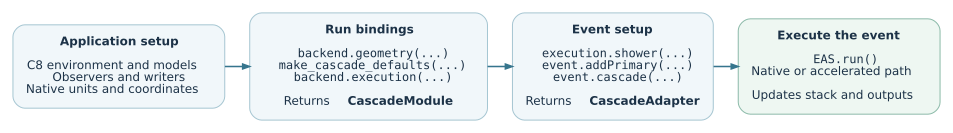
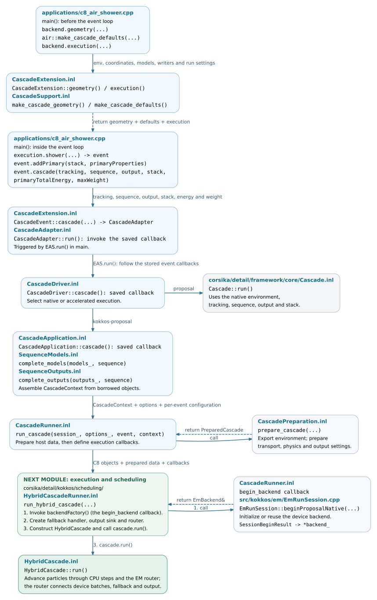

Application integration
=======================

The air-shower application creates the C8 environment, models, observers and
process sequence. The application interface binds those objects to an execution
path and exposes the event through ``EAS.run()``. This chapter follows that
connection from the call in ``main`` to the code that starts a cascade.

.. note::

   Source baseline: `d5297c43
   <https://github.com/BossL668/CORSIKA8-kokkos/tree/d5297c43c041a22b43c65c322d9b51bc7ec8e397>`_.
   The following pages describe the current implementation. Code excerpts are
   included directly from repository files, with their original identifiers and
   source line numbers. Paths are relative to the project root.

.. _application-source-files:

Source file map
---------------

The selected files below follow the call chain described in this chapter.
Paths start at the repository root; each filename links to the source baseline
recorded above.

The public headers in ``corsika/kokkos/application/`` declare the application
interfaces and data types. Template implementations are under
``corsika/detail/kokkos/application/``, while compiled, non-template
implementations are under ``src/kokkos/application/``.

.. parsed-literal::

   applications/
   └── `c8_air_shower.cpp`_                 main(), C8 setup and event loop

   corsika/kokkos/application/
   ├── `ExecutionSelection.hpp`_            direct/coordinated execution interface
   └── cascade/
       ├── `CascadeExtensionOptions.hpp`_   CascadeExtension declaration
       ├── `CascadeExtension.hpp`_          CascadeModule and CascadeEvent declarations
       ├── `CascadeContext.hpp`_            geometry and context reference bundles
       ├── `CascadeEventConfig.hpp`_        run defaults and per-event settings
       ├── `RunEnvironmentConfig.hpp`_      site and run metadata
       ├── `PreparedCascade.hpp`_           prepared snapshot and backend settings
       ├── `SequenceModels.hpp`_            borrowed model references
       └── `SequenceOutputs.hpp`_           borrowed observer references

   corsika/detail/kokkos/application/cascade/
   ├── `CascadeExtension.inl`_              geometry(), execution(), shower(), cascade()
   ├── `CascadeSupport.inl`_                geometry and defaults factories
   ├── `CascadeAdapter.inl`_                run() and forced-primary flags
   ├── `CascadeDriver.inl`_                 prefix/native/accelerated path selection
   ├── `CascadeApplication.inl`_            event context and accelerated dispatch
   ├── `CascadePreparation.inl`_            prepare_cascade(): host data preparation
   ├── `CascadeRunner.inl`_                 run_cascade(): start the hybrid cascade
   ├── `SequenceModels.inl`_                complete_models(): recover event processes
   └── `SequenceOutputs.inl`_               complete_outputs(): recover event writers

   src/kokkos/application/cascade/
   ├── `CascadeExtension.cpp`_              option registration, prepare(), configure()
   ├── `CascadeSupport.cpp`_                select_execution() and runtime setup
   └── `CascadeRunSession.cpp`_             run-session state and output records

``CascadeExtension.hpp`` is the header included by ``main``. It includes
``CascadeExtensionOptions.hpp``, where the ``CascadeExtension`` class itself is
declared, and defines the ``CascadeModule`` and ``CascadeEvent`` templates.
There are no separate ``CascadeModule.hpp`` or ``CascadeEvent.hpp`` files in
this baseline.

To follow calls beyond the application bindings:

* `ProcessSelection.hpp <https://github.com/BossL668/CORSIKA8-kokkos/blob/d5297c43c041a22b43c65c322d9b51bc7ec8e397/corsika/framework/process/ProcessSelection.hpp>`_ in
  ``corsika/framework/process/`` provides ``select_process(...)``.
* `Cascade.hpp <https://github.com/BossL668/CORSIKA8-kokkos/blob/d5297c43c041a22b43c65c322d9b51bc7ec8e397/corsika/framework/core/Cascade.hpp>`_ in
  ``corsika/framework/core/`` declares the native C8 cascade.
* `EmRunSession.cpp <https://github.com/BossL668/CORSIKA8-kokkos/blob/d5297c43c041a22b43c65c322d9b51bc7ec8e397/src/kokkos/em/EmRunSession.cpp>`_ in
  ``src/kokkos/em/`` implements ``beginProposalNative(...)``.
* `HybridCascadeRunner.inl <https://github.com/BossL668/CORSIKA8-kokkos/blob/d5297c43c041a22b43c65c322d9b51bc7ec8e397/corsika/detail/kokkos/scheduling/HybridCascadeRunner.inl>`_ in
  ``corsika/detail/kokkos/scheduling/`` implements ``run_hybrid_cascade(...)``.

.. _c8_air_shower.cpp: https://github.com/BossL668/CORSIKA8-kokkos/blob/d5297c43c041a22b43c65c322d9b51bc7ec8e397/applications/c8_air_shower.cpp
.. _ExecutionSelection.hpp: https://github.com/BossL668/CORSIKA8-kokkos/blob/d5297c43c041a22b43c65c322d9b51bc7ec8e397/corsika/kokkos/application/ExecutionSelection.hpp
.. _CascadeExtensionOptions.hpp: https://github.com/BossL668/CORSIKA8-kokkos/blob/d5297c43c041a22b43c65c322d9b51bc7ec8e397/corsika/kokkos/application/cascade/CascadeExtensionOptions.hpp
.. _CascadeExtension.hpp: https://github.com/BossL668/CORSIKA8-kokkos/blob/d5297c43c041a22b43c65c322d9b51bc7ec8e397/corsika/kokkos/application/cascade/CascadeExtension.hpp
.. _CascadeContext.hpp: https://github.com/BossL668/CORSIKA8-kokkos/blob/d5297c43c041a22b43c65c322d9b51bc7ec8e397/corsika/kokkos/application/cascade/CascadeContext.hpp
.. _CascadeEventConfig.hpp: https://github.com/BossL668/CORSIKA8-kokkos/blob/d5297c43c041a22b43c65c322d9b51bc7ec8e397/corsika/kokkos/application/cascade/CascadeEventConfig.hpp
.. _RunEnvironmentConfig.hpp: https://github.com/BossL668/CORSIKA8-kokkos/blob/d5297c43c041a22b43c65c322d9b51bc7ec8e397/corsika/kokkos/application/cascade/RunEnvironmentConfig.hpp
.. _PreparedCascade.hpp: https://github.com/BossL668/CORSIKA8-kokkos/blob/d5297c43c041a22b43c65c322d9b51bc7ec8e397/corsika/kokkos/application/cascade/PreparedCascade.hpp
.. _SequenceModels.hpp: https://github.com/BossL668/CORSIKA8-kokkos/blob/d5297c43c041a22b43c65c322d9b51bc7ec8e397/corsika/kokkos/application/cascade/SequenceModels.hpp
.. _SequenceOutputs.hpp: https://github.com/BossL668/CORSIKA8-kokkos/blob/d5297c43c041a22b43c65c322d9b51bc7ec8e397/corsika/kokkos/application/cascade/SequenceOutputs.hpp
.. _CascadeExtension.inl: https://github.com/BossL668/CORSIKA8-kokkos/blob/d5297c43c041a22b43c65c322d9b51bc7ec8e397/corsika/detail/kokkos/application/cascade/CascadeExtension.inl
.. _CascadeSupport.inl: https://github.com/BossL668/CORSIKA8-kokkos/blob/d5297c43c041a22b43c65c322d9b51bc7ec8e397/corsika/detail/kokkos/application/cascade/CascadeSupport.inl
.. _CascadeAdapter.inl: https://github.com/BossL668/CORSIKA8-kokkos/blob/d5297c43c041a22b43c65c322d9b51bc7ec8e397/corsika/detail/kokkos/application/cascade/CascadeAdapter.inl
.. _CascadeDriver.inl: https://github.com/BossL668/CORSIKA8-kokkos/blob/d5297c43c041a22b43c65c322d9b51bc7ec8e397/corsika/detail/kokkos/application/cascade/CascadeDriver.inl
.. _CascadeApplication.inl: https://github.com/BossL668/CORSIKA8-kokkos/blob/d5297c43c041a22b43c65c322d9b51bc7ec8e397/corsika/detail/kokkos/application/cascade/CascadeApplication.inl
.. _CascadePreparation.inl: https://github.com/BossL668/CORSIKA8-kokkos/blob/d5297c43c041a22b43c65c322d9b51bc7ec8e397/corsika/detail/kokkos/application/cascade/CascadePreparation.inl
.. _CascadeRunner.inl: https://github.com/BossL668/CORSIKA8-kokkos/blob/d5297c43c041a22b43c65c322d9b51bc7ec8e397/corsika/detail/kokkos/application/cascade/CascadeRunner.inl
.. _SequenceModels.inl: https://github.com/BossL668/CORSIKA8-kokkos/blob/d5297c43c041a22b43c65c322d9b51bc7ec8e397/corsika/detail/kokkos/application/cascade/SequenceModels.inl
.. _SequenceOutputs.inl: https://github.com/BossL668/CORSIKA8-kokkos/blob/d5297c43c041a22b43c65c322d9b51bc7ec8e397/corsika/detail/kokkos/application/cascade/SequenceOutputs.inl
.. _CascadeExtension.cpp: https://github.com/BossL668/CORSIKA8-kokkos/blob/d5297c43c041a22b43c65c322d9b51bc7ec8e397/src/kokkos/application/cascade/CascadeExtension.cpp
.. _CascadeSupport.cpp: https://github.com/BossL668/CORSIKA8-kokkos/blob/d5297c43c041a22b43c65c322d9b51bc7ec8e397/src/kokkos/application/cascade/CascadeSupport.cpp
.. _CascadeRunSession.cpp: https://github.com/BossL668/CORSIKA8-kokkos/blob/d5297c43c041a22b43c65c322d9b51bc7ec8e397/src/kokkos/application/cascade/CascadeRunSession.cpp

Read the interface in execution order
-------------------------------------

.. toctree::
   :maxdepth: 1

   application/setup
   application/data-contracts
   application/event-execution

The first page covers process selection and setup. The second follows the
arguments into their receiving objects. The third follows an individual event,
including the native and accelerated branches and the output they update.

   The direct application path. Multi-GPU and parallel-prefix coordination is
   selected before this setup; each worker then uses the application interfaces
   for its assigned work. :download:`Diagram source <_static/application-calls.dot>`.

Names that refer to different responsibilities
----------------------------------------------

.. list-table::
   :header-rows: 1
   :widths: 32 68

   * - Name in ``main``
     - Concrete role
   * - ``executionMode``
     - An ``ExecutionSelection`` value. It selects direct execution or the
       process coordinator before model setup.
   * - ``backend``
     - A ``CascadeExtension`` object. It registers options, configures library
       resources and creates the application bindings. It is not a GPU kernel
       or an ``EmBackend`` instance.
   * - ``geometry`` / ``defaults``
     - A ``CascadeGeometry<...>`` bundle of references to scene objects and a
       ``CascadeEventConfig`` value containing run defaults.
   * - ``execution``
     - A ``CascadeModule<...>`` that retains the driver and bindings across
       events. It is distinct from ``executionMode``.
   * - ``event``
     - A ``CascadeEvent<...>`` for one shower, including its input and diagnostic
       bookkeeping.
   * - ``EAS``
     - A ``CascadeAdapter<...>`` returned by ``event.cascade(...)``. Its
       ``run()`` call executes the selected path; the native branch constructs
       a C8 ``Cascade`` internally.

What crosses the application interface
--------------------------------------

The application supplies native C++ objects and typed quantities: its environment,
coordinate system, particle stack, process sequence, model instances and output
writers. The binding structs mainly hold references to those objects. Numerical
environment snapshots, model-table export and device uploads occur later inside
the accelerated execution path.

Most execution functions return ``void`` and write through the supplied stack,
writers or run-session objects. An event is therefore not returned as one new
"shower result" value. The detailed contracts below distinguish returned objects
from state changes and output records.

Maintenance entry points
------------------------

.. list-table::
   :header-rows: 1
   :widths: 36 64

   * - Change under consideration
     - Start reading here
   * - Direct versus coordinated execution
     - ``ExecutionSelection.hpp`` and ``CascadeSupport.cpp``;
       see :doc:`application/setup`.
   * - New application inputs or lifetimes
     - ``CascadeExtensionOptions.hpp``, ``CascadeContext.hpp`` and
       ``CascadeSupport.inl``; see :doc:`application/data-contracts`.
   * - Processes recovered from the event sequence
     - ``SequenceModels.inl``, ``SequenceOutputs.inl`` and
       ``ProcessSelection.hpp``; see :doc:`application/event-execution`.
   * - Starting or reusing device execution
     - ``CascadeRunner.inl`` and ``EmRunSession.cpp``;
       see :ref:`application-backend-start`.

The older ``bind(...)`` and ``dispatch_cascade(...)`` helpers remain in the
library. The air-shower ``main`` described here uses ``select_execution(...)``,
``geometry(...)`` and ``execution(...)`` instead. Their presence in the source
should not be mistaken for additional calls made by this entry point.

.. _application-source-flow:

Follow the data from main to the scheduling module
------------------------------------------------------------

The following diagram connects the calls in ``main`` to their implementation
files and the next module. It follows an ordinary event using
``--em-backend kokkos-proposal``, with the native ``proposal`` branch shown
alongside it. Process coordination is selected before this path; a dedicated
prefix task can return earlier through ``input.runPrefix(...)``. The EGS4
session has a separate execution branch described in
:doc:`application/event-execution`.

   Read from top to bottom. Solid arrows follow execution and helper calls;
   dashed arrows identify returned objects. Each box names the file and the
   relevant function or callback. Green boxes mark the handoff to execution
   and scheduling. Open the full-size SVG to follow its clickable source links.
   :download:`SVG <_static/application-source-flow.svg>` /
   :download:`Editable DOT source <_static/application-source-flow.dot>`.

Except where a full path is shown, application ``.inl`` files in this figure
are under ``corsika/detail/kokkos/application/cascade/``. Both green boxes are
under ``corsika/detail/kokkos/scheduling/``.

The handoff passes ``begin_backend`` as a callback to
``run_hybrid_cascade(...)``. That function invokes it to obtain ``EmBackend&``
before constructing the router and starting ``HybridCascade::run()``. The
application therefore supplies the inputs and initialization callback; the
scheduling module controls this execution order. Continue with
:doc:`execution` for the hybrid loop, batch contracts and process coordination.
