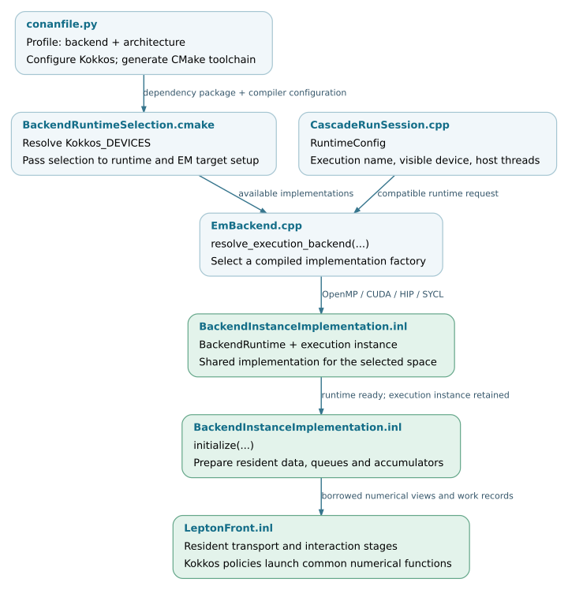

.. _build-and-backend-portability:

CPU and GPU backend development
===============================

Backend development concerns how shared calculations are compiled, how their
data are stored and how work is submitted to CPU threads or GPU devices.
The numerical model should remain in the common implementation whenever its
inputs and outputs are unchanged. Backend-specific work belongs in the
runtime, data-transfer or execution-policy code that requires it.

Use :doc:`usage/installation` to prepare a working installation. This chapter
explains how to develop and maintain the code behind that installation.
Examples refer to the guide's ``d5297c43`` source baseline; supported build
configurations and actual validation on particular hardware are identified
separately.

Backend development tasks
-------------------------

.. list-table::
   :header-rows: 1
   :widths: 29 44 27

   * - Task
     - Implementation work
     - Detailed guide
   * - Prepare or update a build
     - Match the Kokkos execution spaces, compiler, architecture and CORSIKA
       targets; verify both the build tree and installed package.
     - :doc:`backends/build`
   * - Change resource selection or session reuse
     - Preserve device visibility, initialization ownership and the lifetime
       of views and execution-space instances across events.
     - :doc:`backends/runtime`
   * - Add a calculation to device execution
     - Audit its complete call chain, accessible data and output ownership;
       register tests with the device compiler.
     - :doc:`backends/device-code`
   * - Tune launches, scans or synchronization
     - Change the execution policy or a narrow backend adapter; measure the
       affected stages and complete showers with matched inputs.
     - :doc:`backends/device-code`, :doc:`validation/performance`
   * - Establish support for another platform
     - Verify compilation, runtime lifecycle, numerical tests and application
       execution on that platform; record the tested toolchain and device.
     - :doc:`validation/tests`, :doc:`validation/numerics`

.. toctree::
   :maxdepth: 1
   :hidden:

   backends/build
   backends/runtime
   backends/device-code

Shared implementation and backend-specific code
-----------------------------------------------

The OpenMP, CUDA and HIP factories instantiate
``BackendInstanceImplementation<TExecutionSpace>``. The HIP factory, for
example, selects the execution space without reimplementing transport:

.. literalinclude:: ../../src/kokkos/em/HipBackendInstance.cpp
   :language: cpp
   :lines: 11-14
   :lineno-match:

``EmBackend`` selects the factory. The resulting implementation owns the
execution instance, tables, environment arrays, queues and accumulators.
It also contains specific handling for resource queries, scans, waits and
launch policies. When adding backend support, inspect these operations in
addition to compiling the common physics functions. See `EmBackend.cpp`_
and `BackendInstanceImplementation.inl`_.

Build selection and runtime selection serve different purposes. The build
provides the compiled implementations; application options select a compatible
implementation and resources. A process coordinator distributes work between
application processes. It does not create another Kokkos execution space.
The exact build combinations, including the experimental CUDA/OpenMP build
and the available SYCL factory, are documented in :doc:`backends/build`.

Source organization
-------------------

Build configuration selects and exports library targets. Public runtime
interfaces are under ``corsika/kokkos/runtime`` and their compiled
implementations are under ``src/kokkos/runtime``. Application device parsing
is separate from runtime lifetime and from the EM implementation factories.

.. include:: backends/_file-map.txt

Development verification
-------------------------

Start with runtime and storage tests on the selected backend, followed by
the affected numerical stages and application path. Include multiple events
when changing session reuse, and explicit worker execution when changing
coordination. :doc:`validation/tests` identifies the registrations and
selectors. Host-only tests do not exercise device kernels or device-specific
synchronization.

Retain the resolved ``RuntimeInfo``, build configuration and tuning settings
with test results. These identify the execution implementation but do not
replace the physical conditions, table identities or random-stream policy.
For performance changes, report both the affected operation and the event
measurement as described in :doc:`validation/performance`.

Build-to-execution flow
-----------------------

The build determines the available factories. At run time, the application
supplies a compatible ``RuntimeConfig``; the selected implementation acquires
its runtime and initializes resident storage before submitting kernels. The
process coordinator, when selected, repeats this local setup within each GPU
worker rather than creating one cross-device Kokkos execution instance.

   Build selection and runtime handoff for the standard EM backend. Open the
   SVG for links to the checked source revision.
   :download:`SVG <_static/backend-configuration-flow.svg>` ·
   :download:`Editable DOT source <_static/backend-configuration-flow.dot>`.

.. _EmBackend.cpp: https://github.com/BossL668/CORSIKA8-kokkos/blob/d5297c43c041a22b43c65c322d9b51bc7ec8e397/src/kokkos/em/EmBackend.cpp
.. _BackendApplicationTargets.cmake: https://github.com/BossL668/CORSIKA8-kokkos/blob/d5297c43c041a22b43c65c322d9b51bc7ec8e397/cmake/BackendApplicationTargets.cmake
.. _BackendInstanceImplementation.inl: https://github.com/BossL668/CORSIKA8-kokkos/blob/d5297c43c041a22b43c65c322d9b51bc7ec8e397/corsika/detail/kokkos/em/execution/BackendInstanceImplementation.inl
