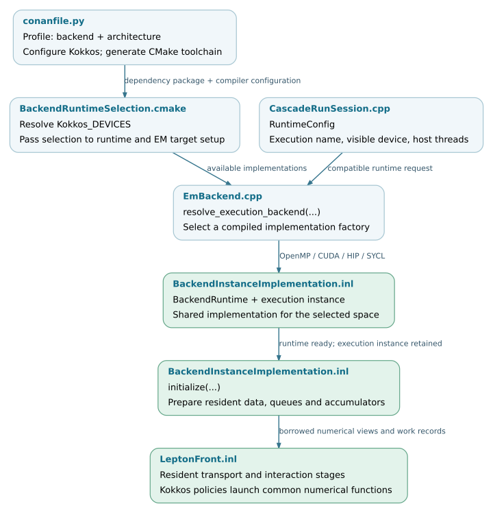

Build and backend portability
=============================

The Kokkos integration separates physical models, execution-space
implementations and process coordination. A build supplies particular
execution-space implementations; runtime options select compatible resources
and application routes. Portability requires both device-callable numerical
code and a valid memory, runtime and toolchain configuration.

Use :doc:`usage/installation` for installation commands and
:doc:`usage/parallel-execution` for running a configured application. This
chapter explains the source-level contracts behind those commands.

.. note::

   Source baseline: `d5297c43
   <https://github.com/BossL668/CORSIKA8-kokkos/tree/d5297c43c041a22b43c65c322d9b51bc7ec8e397>`_.
   Build support, executable test coverage and validation on particular
   hardware are separate claims. The tables below describe implementation
   paths in this revision; they are not a certification matrix for devices
   or compiler versions.

Configuration layers
--------------------

.. list-table::
   :header-rows: 1
   :widths: 24 36 40

   * - Layer
     - Configuration
     - Effect
   * - Physics and application route
     - ``--em-backend`` and ``--radio-backend``
     - Select native or accelerated implementations of the requested
       calculations. Availability depends on compiled targets and application
       support.
   * - Compiled execution support
     - Kokkos dependency options, architecture profile and
       ``CORSIKA_KOKKOS_BACKEND``
     - Determine which numerical implementations the library contains and
       which compiler generates them.
   * - Runtime resources
     - ``--kokkos-execution``, ``--device`` and
       ``--kokkos-num-threads``
     - Select a compatible execution implementation, visible device or host
       thread configuration. They cannot add a missing compiled backend.
   * - Process coordination
     - Device list and ``--prefix-workers``
     - Select direct execution or worker processes. Coordination distributes
       work across application processes; it is not a Kokkos execution space.
   * - Kernel and queue configuration
     - ``TuningParameters``, memory budget and dispatch thresholds
     - Control launch geometry, storage and work submission within the
       selected implementation.

Changing the EM backend is not equivalent to selecting CUDA or HIP: the same
``kokkos-proposal`` numerical path can run with different compiled execution
spaces. Conversely, changing the execution space does not port a CPU-only
external physics library. CPU completion routes remain part of the hybrid
cascade. See :doc:`application` and :doc:`transport/interactions`.

.. toctree::
   :maxdepth: 1

   backends/build
   backends/runtime
   backends/device-code

Compiled implementation paths
-----------------------------

The top-level build defaults to ``CORSIKA_ENABLE_KOKKOS=OFF``. Enabling it adds
the generic runtime and numerical/data targets. The production
``BackendRuntime`` and EM implementation are then selected from the dependency's
``Kokkos_DEVICES``. Explicit requests incompatible with that dependency are
configuration errors. ``AUTO`` and ``NONE`` have different roles from turning
Kokkos off; :doc:`backends/build` documents the exact rules.

.. list-table::
   :header-rows: 1
   :widths: 24 36 40

   * - Build selection
     - EM implementation
     - Scope
   * - ``OPENMP``
     - ``BackendInstanceImplementation<Kokkos::OpenMP>``
     - Kokkos kernels execute on CPU threads.
   * - ``CUDA``
     - ``BackendInstanceImplementation<Kokkos::Cuda>``
     - Kokkos kernels execute on a selected NVIDIA device.
   * - ``HIP``
     - ``BackendInstanceImplementation<Kokkos::HIP>``
     - Kokkos kernels execute on a selected HIP device with a matching
       architecture and ROCm/DTK toolchain.
   * - ``SYCL``
     - ``BackendInstanceImplementation<Kokkos::SYCL>``
     - A source implementation is present. Its existence does not establish
       validation on a particular SYCL device or compiler.
   * - ``CUDA_OPENMP``
     - CUDA and OpenMP implementations plus a cooperative adapter
     - Optional experimental combined build. Selection, shared runtime
       ownership and cooperation have additional contracts.

These are instantiations of a shared implementation, rather than separate
copies of all physics functions. For example, the HIP factory is:

.. literalinclude:: ../../src/kokkos/em/HipBackendInstance.cpp
   :language: cpp
   :lines: 11-14
   :lineno-match:

``EmBackend`` resolves the requested execution mode and calls the corresponding
factory. ``BackendInstanceImplementation`` owns the execution instance,
resident tables, environment data, queues and accumulators. Its implementation
contains execution-space-specific branches for operations such as resource
queries, scans, waits and launch policies. A common template therefore does
not imply identical low-level instructions or synchronization on all devices.
See `EmBackend.cpp`_, `BackendApplicationTargets.cmake`_ and
`BackendInstanceImplementation.inl`_.

Runtime identity and reproducibility
------------------------------------

``RuntimeInfo`` records the selected backend, device, architecture, compiler,
Kokkos and driver/runtime versions, concurrency and memory information.
``TuningCache`` associates launch parameters with runtime and build metadata.
These records help distinguish a change in the algorithm from a change in
its execution configuration. They do not replace the physical run conditions,
model/table identities, random-stream policy or event seed.

The public runtime classes have different ownership contracts. Generic
``Runtime`` can manage or borrow the process Kokkos lifetime. Production
``BackendRuntime`` owns initialization or uses an explicit cooperative lease.
Neither class can safely be recreated after its owned Kokkos runtime has
been finalized. Keep the appropriate owner alive across event reuse and
release device work and allocations before releasing that owner. The exact
rules, including external initialization and thread ownership, are in
:doc:`backends/runtime`.

Source organization
-------------------

Build configuration selects and exports library targets. Public runtime
interfaces are under ``corsika/kokkos/runtime`` and their compiled
implementations are under ``src/kokkos/runtime``. Application device parsing
is separate from runtime lifetime and from the EM implementation factories.

.. include:: backends/_file-map.txt

Validation coverage
-------------------

Backend validation has several levels: command/configuration checks, process
lifecycle, device primitives, numerical kernels and complete events. A host-only
parser test cannot establish GPU visibility or device execution. Likewise,
passing primitive tests does not establish complete-shower physics agreement.

.. include:: backends/_checks.txt

The existing CMake test registrations select the compiled backend and, where
needed, compile test translation units with the device compiler. The pinned
GitLab pipeline does not configure a Kokkos backend matrix. Test registration
is therefore not evidence that every backend runs automatically in CI. See
:doc:`backends/device-code` for the current boundary and requirements for
extending coverage.

Build-to-execution flow
-----------------------

The build determines the available factories. At run time, the application
supplies a compatible ``RuntimeConfig``; the selected implementation acquires
its runtime and initializes resident storage before submitting kernels. The
process coordinator, when selected, repeats this local setup within each GPU
worker rather than creating one cross-device Kokkos execution instance.

   Build selection and runtime handoff for the standard EM backend. Open the
   SVG for links to the checked source revision.
   :download:`SVG <_static/backend-configuration-flow.svg>` ·
   :download:`Editable DOT source <_static/backend-configuration-flow.dot>`.

.. _EmBackend.cpp: https://github.com/BossL668/CORSIKA8-kokkos/blob/d5297c43c041a22b43c65c322d9b51bc7ec8e397/src/kokkos/em/EmBackend.cpp
.. _BackendApplicationTargets.cmake: https://github.com/BossL668/CORSIKA8-kokkos/blob/d5297c43c041a22b43c65c322d9b51bc7ec8e397/cmake/BackendApplicationTargets.cmake
.. _BackendInstanceImplementation.inl: https://github.com/BossL668/CORSIKA8-kokkos/blob/d5297c43c041a22b43c65c322d9b51bc7ec8e397/corsika/detail/kokkos/em/execution/BackendInstanceImplementation.inl
