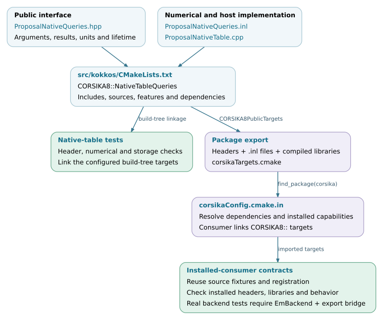

Development and maintenance
===========================

Maintenance of the Kokkos integration requires preserving the contracts
between native C8 objects, numerical data, execution services and physics
outputs. The application constructs the physical problem; library components
convert its data, execute calculations and return results. A change should be
implemented at the layer responsible for that behavior and reviewed against
the components that depend on it.

This chapter describes the source organization, extension points and review
workflow for contributors. It complements :doc:`backends` and
:doc:`validation`, which document build/runtime requirements and how to test
correctness and performance.

.. note::

   Implementation baseline: `d5297c43
   <https://github.com/BossL668/CORSIKA8-kokkos/tree/d5297c43c041a22b43c65c322d9b51bc7ec8e397>`_.
   Existing source contracts and recommended development practices are
   distinguished below. These recommendations do not establish an official
   CORSIKA integration policy or certify every file's compliance with current
   upstream conventions. Changes intended for upstream should follow the
   target branch's requirements and review process.

.. toctree::
   :maxdepth: 1

   development/workflow
   development/extensions
   development/compatibility

Component responsibilities
--------------------------

The following boundaries identify where to begin a change. They also identify
what should remain outside the component's responsibility.

.. list-table::
   :header-rows: 1
   :widths: 23 42 35

   * - Component
     - Responsibility and source entry points
     - Contract to preserve
   * - Application integration
     - Native scene, models, process sequence and outputs in
       `c8_air_shower.cpp`_; library binding and execution in
       `CascadeExtension.hpp`_.
     - Explicit configuration and object lifetimes. Particle scheduling and
       reaction-specific completion belong in library components.
   * - Host conversion and preparation
     - Native particle conversion, environment export and table preparation;
       see :doc:`particles`, :doc:`environment` and :doc:`physics-data`.
     - Physical units, coordinates, material and node identities, supported
       domains and immutable prepared inputs.
   * - Numerical calculations
     - Table queries, geometry, transport, final states and radio projection;
       see :doc:`transport` and :doc:`radio`.
     - Physics definitions, numerical domains, random inputs and result
       conventions. Numerical functions should not acquire process-global
       runtimes or own application objects.
   * - Execution and resident storage
     - `BackendInstanceImplementation.inl`_ and the runtime, queue and
       accumulator owners.
     - Execution-instance ordering, valid memory access, ownership,
       capacities and completion before storage release.
   * - Routing and coordination
     - `EmRouter.inl`_, `HybridCascade.inl`_ and
       `AirShowerCoordinator.cpp`_.
     - Complete particle-state transfer, CPU/device handoff, static worker
       assignments, event completion and output merging.
   * - Output and diagnostics
     - Native output libraries and Kokkos record projection/reporting;
       see :doc:`usage/outputs` and :doc:`validation/performance`.
     - Observable definitions, units, event identity, normalization,
       completion status and the actual scope of each measurement.

The public host interface ``IEmBackend`` separates the router from a selected
execution implementation. The shared numerical implementation is instantiated
for different execution spaces; narrow backend-specific adapters handle
operations such as runtime queries and completion. A device optimization
therefore need not introduce a second copy of the physical model. See
`IEmBackend.hpp`_ and :doc:`backends/device-code`.

Review the kind of change explicitly
------------------------------------

Separate a structural refactor from a change in numerical or physical
behavior. File movement, interface simplification and target reorganization
can still affect ownership, includes, compile definitions and instantiation.
Retain fixed-input comparisons and installed-consumer checks for those
changes. Do not silently modify a reference implementation to make a changed
candidate pass.

A numerical optimization needs a documented domain, reference, tolerance and
performance workload. A scheduling change additionally needs a stated
random-stream policy, queue-accounting checks and complete-shower validation
when histories change. A new physics model needs independent physical
validation; preserving an older implementation is only one source of
evidence. The detailed selection of tests is in :doc:`validation`.

When behavior changes intentionally, describe the previous and new behavior
with a concrete input or configuration. Record the reason, expected output
differences and compatibility impact. For a retained reference fixture,
either preserve it as the old-behavior regression or update it with an
explicit rationale and an independent check of the corrected behavior.

Interface review
----------------

Before changing a public declaration, transferred record or serialized
format, identify its producer, owners, consumers and validation points.
Review these contracts together:

* **Values:** units, coordinate system, physical meaning, index domains,
  sentinel values and allowed numerical range.
* **Storage:** owning versus borrowed data, memory space, object lifetime,
  transfer direction and invalidation after a resize or scene change.
* **Execution:** permitted calling thread, execution instance, asynchronous
  completion, mutable state and session reuse.
* **Results:** successful and failed outcomes, whether partial output is
  valid, CPU completion requests and associated counters.
* **Reproducibility:** particle and event identities, random keys, stream
  progression, ordering and accumulation conventions.
* **Compatibility:** exported headers/targets, dependencies, cache keys,
  on-disk formats and downstream analysis.

These are recommended review checks, not a reason to repeat the same checks in
every inner numerical operation. Validate configuration and persistent data
at their entry points where possible; retain runtime checks required by the
actual calculation or ownership contract. Changing a domain guard, fallback
condition or overflow policy changes behavior and requires corresponding
tests.

Source and installed interfaces
-------------------------------

The directory layout separates public declarations, inline implementations,
compiled libraries, application entry points and tests:

.. code-block:: text

   applications/                     # Application entry points
   corsika/kokkos/                    # Public Kokkos integration interfaces
   corsika/detail/kokkos/             # Inline/template implementation bodies
   src/kokkos/                       # Compiled implementation and target definitions
   cmake/                            # Backend targets, package export, contract tests
   tests/kokkos/                     # Numerical, storage and execution checks
   tests/application_support/        # CLI, application and coordinator contracts
   documentation/kokkos/             # Maintainer and user documentation

For the detailed naming and formatting rules, see :doc:`development/workflow`.
The implementation still has legacy identifiers and heterogeneous test
fixtures; this layout is not evidence that every historical name satisfies
all current conventions.

`src/kokkos/CMakeLists.txt`_ defines many public targets and includes the
runtime/application target definitions. Exported names such as
``CORSIKA8::NativeTableQueries`` are part of the consumer interface. A new
public target needs its dependencies, include directories, compile features
and installation/export entry considered together.

The top-level installation excludes ``kokkos`` from the unconditional native
header copy. The enabled Kokkos subdirectory installs both
``corsika/kokkos`` and ``corsika/detail/kokkos`` and adds its targets to
``CORSIKA8PublicTargets``. The package publishes ``corsikaTargets.cmake``
under the ``CORSIKA8::`` namespace. Thus an included ``.inl`` is required by
installed consumers even though it is an implementation file. A
``detail`` path is not a binary-compatibility boundary. See
`CMakeLists.txt`_, `corsikaConfig.cmake.in`_ and the installed-consumer example
in :doc:`validation/tests`.

Development and release evidence
--------------------------------

A review should include the changed interfaces and implementation, affected
callers and formats, updated tests, documentation and a reproducible result.
Use the :download:`comparison manifest
<_static/validation-manifest.json>` when the change needs numerical,
statistical or performance evidence. Keep raw logs and analysis with the
report rather than relying on a plot alone.

Changes to a dependency, compiler or device architecture require the same
care as changes to source code. Recheck availability, numerical behavior,
resource lifetime and performance for the affected path. A compiled template
instantiation or a passing documentation build does not establish execution
on that device. :doc:`development/compatibility` describes the versioned data
contracts, diagnostic entry points and a recommended release review.

Documentation changes should retain their checked source revision and keep
examples, file maps, interface descriptions and diagrams consistent. Use real
source excerpts where possible. When a limitation is removed, update the
corresponding supported-domain and test-coverage descriptions as part of the
same change.

Source-to-consumer dependency flow
----------------------------------

The diagram uses the native-table component to illustrate the public target
and installation path. Build-tree and
installed-consumer tests exercise different configurations of that path; both
are needed when a change affects exports or transitive dependencies.
Their registration depends on the configured capabilities: the installed
real-backend execution tests require both ``EmBackend`` and the
real native export bridge. Check the registered tests for the build being
reviewed.

   Public interfaces, target definitions and consumer checks. Open the SVG for
   links to the corresponding source files.
   :download:`SVG <_static/maintenance-interface-flow.svg>` ·
   :download:`Editable DOT source <_static/maintenance-interface-flow.dot>`.

.. _c8_air_shower.cpp: https://github.com/BossL668/CORSIKA8-kokkos/blob/d5297c43c041a22b43c65c322d9b51bc7ec8e397/applications/c8_air_shower.cpp
.. _CascadeExtension.hpp: https://github.com/BossL668/CORSIKA8-kokkos/blob/d5297c43c041a22b43c65c322d9b51bc7ec8e397/corsika/kokkos/application/cascade/CascadeExtension.hpp
.. _BackendInstanceImplementation.inl: https://github.com/BossL668/CORSIKA8-kokkos/blob/d5297c43c041a22b43c65c322d9b51bc7ec8e397/corsika/detail/kokkos/em/execution/BackendInstanceImplementation.inl
.. _EmRouter.inl: https://github.com/BossL668/CORSIKA8-kokkos/blob/d5297c43c041a22b43c65c322d9b51bc7ec8e397/corsika/detail/kokkos/scheduling/EmRouter.inl
.. _HybridCascade.inl: https://github.com/BossL668/CORSIKA8-kokkos/blob/d5297c43c041a22b43c65c322d9b51bc7ec8e397/corsika/detail/kokkos/scheduling/HybridCascade.inl
.. _AirShowerCoordinator.cpp: https://github.com/BossL668/CORSIKA8-kokkos/blob/d5297c43c041a22b43c65c322d9b51bc7ec8e397/src/kokkos/scheduling/AirShowerCoordinator.cpp
.. _IEmBackend.hpp: https://github.com/BossL668/CORSIKA8-kokkos/blob/d5297c43c041a22b43c65c322d9b51bc7ec8e397/corsika/kokkos/em/execution/IEmBackend.hpp
.. _src/kokkos/CMakeLists.txt: https://github.com/BossL668/CORSIKA8-kokkos/blob/d5297c43c041a22b43c65c322d9b51bc7ec8e397/src/kokkos/CMakeLists.txt
.. _CMakeLists.txt: https://github.com/BossL668/CORSIKA8-kokkos/blob/d5297c43c041a22b43c65c322d9b51bc7ec8e397/CMakeLists.txt
.. _corsikaConfig.cmake.in: https://github.com/BossL668/CORSIKA8-kokkos/blob/d5297c43c041a22b43c65c322d9b51bc7ec8e397/cmake/corsikaConfig.cmake.in
