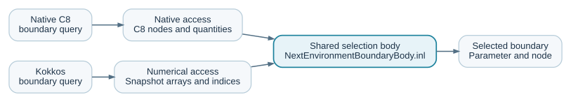

Sharing numerical algorithms with native C8
===========================================

The long-term maintenance goal is to keep one implementation of a numerical
rule wherever native C8 and Kokkos can use it. Data access and execution can
remain different: native C8 operates through its particle and model
interfaces, while Kokkos processes batches in accessible numerical storage.
This page distinguishes the sharing already present from a recommended path
for reducing the remaining duplication.

What is already shared
----------------------

.. list-table::
   :header-rows: 1
   :widths: 27 43 30

   * - Component
     - Current implementation
     - Maintenance consequence
   * - Kokkos transport calculations
     - Common numerical source is called by the OpenMP, CUDA and HIP execution
       implementations.
     - Fix the common calculation once, then verify it on the affected backends.
   * - Environment boundary selection
     - Native and Kokkos wrappers include the same
       ``NextEnvironmentBoundaryBody.inl`` algorithm body.
     - Selection-order changes can be maintained in one body. The geometry
       access and intersection implementations still need their own checks.
   * - PROPOSAL physics tables
     - The host exporter copies native table coefficients; Kokkos has its own
       table-query and inverse-sampling implementation.
     - Shared data preserve the configured model, but the numerical code is
       not automatically shared with PROPOSAL.
   * - Native final-state generators
     - Host completion calls the existing C8/PROPOSAL or hadronic model where
       that interaction is completed on CPU.
     - Keep the completion adapter compatible with the native interface and
       preserve the selected vertex and process information.

Example: shared environment boundary selection
----------------------------------------------

The two ``next_environment_boundary`` wrappers are defined in
`native NextEnvironmentBoundary.inl`_ and `Kokkos NextEnvironmentBoundary.inl`_.
Both include `NextEnvironmentBoundaryBody.inl`_. That body asks an access
object for intersections and for the current node's parent, children and
excluded nodes, then returns the selected parameter and node.

   Existing code sharing at the boundary-selection level.
   :download:`DOT source <../_static/shared-boundary-maintenance.dot>`.

The native adapter can use C8 node objects and physical quantities. The
numerical adapter uses exported data and node indices. Neither wrapper needs
a second copy of the parent/child/exclusion selection rule. This does **not**
mean every shape-intersection formula is identical: the geometry chapter
separately documents the native and numerical intersection paths.

This is an existing example of a maintainable boundary. Reusing its exact
include-body technique elsewhere is not a requirement; an ordinary template
or a small common numerical function may be clearer for another calculation.

Recommended extraction of another shared calculation
----------------------------------------------------

**This is a development approach, not a claim that all C8 algorithms already
use a common implementation.** Apply it to one calculation at a time:

1. Identify its physical inputs and outputs. Separate the calculation from
   table construction, file access, particle-stack mutation and kernel launch.
2. Give it a narrow input interface: numerical values, a read-only table view
   or an accessor with the operations the algorithm needs. State units and
   coordinate conventions at that boundary.
3. Keep a native wrapper that obtains those inputs from C8 objects, and a
   Kokkos wrapper that obtains them from device-accessible storage. Both call
   the same calculation. Runtime selection belongs outside its inner loop.
4. Make the complete device call chain compilable for the target. Select
   supported math and data-access operations; retain error information that
   the caller can handle. Allocation, logging and host-only library calls
   remain in the host preparation or completion layer.
5. Compare the native wrapper and device execution on identical prepared
   inputs. Test endpoint behavior and statuses as well as typical values,
   then verify integration and performance before replacing the old path.

Keep random inputs explicit, or pass a well-defined random-number interface,
when extracting a sampler. That allows a fixed-input comparison to distinguish
a numerical change from a different random sequence.

Sharing source requires more than an annotation
-----------------------------------------------

A device-callable annotation tells the compiler where to compile a function;
it does not copy the objects the function reads or make a host-only library
callable on the GPU. Every operation in the call chain must be supported, and
the referenced data must be accessible in that execution space. See the
`Kokkos function-annotation documentation`_ and :doc:`../backends/device-code`.

Classes, templates and unit-aware value types are not inherently forbidden on
a GPU. Their implementation and accessed storage determine whether they can
be used. A small value type may be reusable; an object that reaches a host
virtual interface, host allocation or external library needs an adapter or
another implementation. The same distinction applies to C8 coordinate and
environment objects.

For external libraries such as PROPOSAL, sharing a numerical routine also
requires an interface and dependency arrangement agreed with that library.
Exporting table coefficients is the existing integration boundary; it does
not make the library's internal C++ implementation device-callable. Keep a
verified adapter until a shared replacement is available.

Priorities for incremental maintenance
--------------------------------------

Start with self-contained calculations whose inputs can be stated clearly:
geometry selection, interpolation, root solving or a final-state formula.
Choose a case with a useful independent reference and a manageable dependency
chain. Review one shared routine and its wrappers before broadening the change.

Keep particle queues, memory management and kernel policies in the execution
layer. The native C8 loop and a Kokkos batch do not need identical scheduling
to share a numerical calculation. Where sharing is not yet practical, document
the reference algorithm, the reason for a separate implementation and the
comparison that must be rerun when either side changes.

The exact upstream location and dependency policy for common helpers should
be agreed with the CORSIKA maintainers. The existing layout supplies a working
example, rather than requiring all common code to be placed under ``kokkos``.

.. _native NextEnvironmentBoundary.inl: https://github.com/BossL668/CORSIKA8-kokkos/blob/d5297c43c041a22b43c65c322d9b51bc7ec8e397/corsika/detail/framework/geometry/NextEnvironmentBoundary.inl
.. _Kokkos NextEnvironmentBoundary.inl: https://github.com/BossL668/CORSIKA8-kokkos/blob/d5297c43c041a22b43c65c322d9b51bc7ec8e397/corsika/detail/kokkos/environment/NextEnvironmentBoundary.inl
.. _NextEnvironmentBoundaryBody.inl: https://github.com/BossL668/CORSIKA8-kokkos/blob/d5297c43c041a22b43c65c322d9b51bc7ec8e397/corsika/detail/framework/geometry/NextEnvironmentBoundaryBody.inl
.. _Kokkos function-annotation documentation: https://kokkos.org/kokkos-core-wiki/API/core/macros-special/host_device_macros.html
