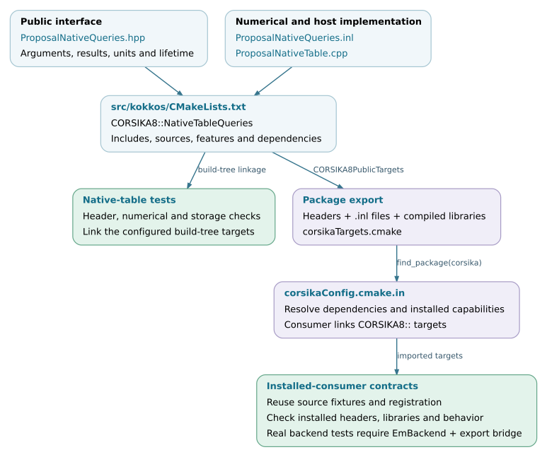

Code organization and modification guide
========================================

Start from the operation being changed, then follow its caller and data
preparation. The files below separate application configuration, numerical
calculations and execution. This makes it possible to review a physics fix
without also redesigning the application or scheduler.

Repository layout
-----------------

.. code-block:: text

   applications/                     # Construct scenes and run events
   corsika/kokkos/                    # Public integration interfaces
   corsika/detail/kokkos/             # Inline and template implementations
   src/kokkos/                        # Compiled implementations and targets
   tests/kokkos/                      # Component and device tests
   tests/application_support/         # Application and coordinator tests
   cmake/                             # Build, export and consumer checks
   documentation/kokkos/              # User and maintainer documentation

The native interfaces remain under ``corsika/framework``, ``corsika/media``
and ``corsika/modules``. Their presence outside ``kokkos`` does not mean they
are unused: the host adapters connect to these interfaces. The `library layout`_
identifies the shared modules and the atmosphere, ice and firn subdirectories.

Public declarations use ``.hpp`` files. Inline/template definitions normally
mirror the header path under ``corsika/detail/kokkos`` with an ``.inl`` suffix;
compiled definitions live under ``src/kokkos``. For example,
``ParticleSoA.hpp`` includes ``corsika/detail/kokkos/data/ParticleSoA.inl``,
whereas ``Runtime.hpp`` is implemented in ``src/kokkos/runtime/Runtime.cpp``.

Modification map
----------------

.. list-table::
   :header-rows: 1
   :widths: 24 45 31

   * - Intended change
     - Implementation to inspect first
     - Related code and checks
   * - Application inputs or backend selection
     - `c8_air_shower.cpp`_ and `CascadeExtension.inl`_.
     - :doc:`../application`; application-support tests. Keep device scheduling
       in the library.
   * - Particle fields, units or coordinates
     - Public records in ``corsika/kokkos/data`` and conversion in
       ``corsika/detail/kokkos/data``.
     - :doc:`../particles`; conversion, storage and CPU/device transfer tests.
   * - Density, geometry or node search
     - ``ModelConversion.inl``, ``ModelEvaluation.inl``, ``ModelGrammage.inl``
       and environment search/boundary adapters.
     - :doc:`../environment`; host and device environment tests.
   * - Table lookup or continuous loss
     - `ProposalNativeQueries.inl`_, `ContinuousPhysicsQueries.inl`_ and
       `LeptonContinuousStep.inl`_.
     - :doc:`../physics-data`, :doc:`../transport`; table and continuous tests.
   * - Interaction selection or secondary generation
     - ``InteractionSelection.inl``, ``ProcessCapabilities.inl`` and the
       selected final-state implementation.
     - :doc:`../transport/interactions`; selection, final-state and CPU
       fallback tests.
   * - Radio projection or propagation
     - ``corsika/detail/kokkos/radio`` and the relevant atmosphere, ice or
       firn implementation.
     - :doc:`../radio`; projection, accumulation and propagation tests.
   * - Batch dispatch or worker coordination
     - `BackendInstanceImplementation.inl`_, `EmRouter.inl`_ and
       `AirShowerCoordinator.cpp`_.
     - :doc:`../execution`; queue, session and coordinator tests, followed by
       event-level checks when execution order changes.

The directory name alone is not enough to choose a file. Read the function's
caller to establish which values it receives and which outputs the next stage
uses. The :doc:`../api` links declarations to the corresponding component
explanations.

Example: changing continuous-energy-loss calculations
-----------------------------------------------------

``query_energy_after_continuous_loss`` accepts a continuous-physics view, a
particle code, initial energy in MeV and traversed grammage in g/cm². It returns
a ``TableQueryResult`` containing a value and status.
``evaluate_lepton_continuous_loss`` calls this query and handles the transport
cut and fallback result. The native PROPOSAL calculators and their exported
range tables are prepared separately.

For a change in range inversion, begin in `ContinuousPhysicsQueries.inl`_
and the native table queries it calls. For a change in how the step handles a
cut, begin in `LeptonContinuousStep.inl`_. Neither change normally belongs in
the application or backend factory.

Use the same table and input values to compare the old and new result,
including zero grammage and the transport endpoint. Existing checks are in
``tests/kokkos/em/continuous/testContinuousQueries.cpp``,
``testContinuousContracts.cpp`` and ``testContinuousQueriesDevice.cpp``.
If the intended numerical result changes, also compare with the native
calculator or an independent reference. A preserved implementation fixture
alone cannot establish that a new physical result is correct.

Coding and build conventions
----------------------------

Follow the `official C8 coding conventions`_ for new code, including naming,
header organization and public API documentation. State input units, returned
values, ownership and failure behavior where relevant. Use the repository's
``.clang-format`` and inspect only the intended changes before submission.
The existing formatter is ``do-clang-format.py``; its default selection is
relative to local ``master``, so check that selection before using ``--apply``.

The guide's source baseline uses **C++17**, while the linked upstream convention
page specifies C++23. Follow the actual target branch's build requirements;
a language-standard upgrade requires its own compiler/dependency review.
See :doc:`../backends/build` for the supported configuration at this baseline.

When adding files, update the responsible target in `src/kokkos/CMakeLists.txt`_
or its included CMake modules. Keep Kokkos optional for native-only consumers.
Public headers that include ``.inl`` implementations require both paths in the
installation. A new dependency or exported target therefore needs an
installed-consumer check as well as a successful application build.

Preparing the review
--------------------

A useful change description states the triggering input or requested feature,
the resulting behavior, and the execution paths tested. Link the nearest
component tests and record the configuration used. Numerical or scheduling
changes need the corresponding checks in :doc:`../validation`; purely
structural changes should preserve the existing results.

Keep independent reference fixtures unchanged unless the reference itself is
being corrected, with evidence for that correction. Update the public header
and component documentation alongside an interface change. Avoid combining a
file reorganization, numerical optimization and scheduling redesign in one
patch: reviewers need to identify which change affects the results.

Library and installation checks
-------------------------------

The following diagram shows the native-table component as an example of the
path from source to an installed consumer. The checks available in a build
depend on its enabled targets; :doc:`../validation/tests` lists their
registration conditions.

   :download:`SVG <../_static/maintenance-interface-flow.svg>` ·
   :download:`DOT source <../_static/maintenance-interface-flow.dot>`.

.. _library layout: https://github.com/BossL668/CORSIKA8-kokkos/blob/d5297c43c041a22b43c65c322d9b51bc7ec8e397/corsika/kokkos/README.md
.. _c8_air_shower.cpp: https://github.com/BossL668/CORSIKA8-kokkos/blob/d5297c43c041a22b43c65c322d9b51bc7ec8e397/applications/c8_air_shower.cpp
.. _CascadeExtension.inl: https://github.com/BossL668/CORSIKA8-kokkos/blob/d5297c43c041a22b43c65c322d9b51bc7ec8e397/corsika/detail/kokkos/application/cascade/CascadeExtension.inl
.. _ProposalNativeQueries.inl: https://github.com/BossL668/CORSIKA8-kokkos/blob/d5297c43c041a22b43c65c322d9b51bc7ec8e397/corsika/detail/kokkos/em/tables/ProposalNativeQueries.inl
.. _ContinuousPhysicsQueries.inl: https://github.com/BossL668/CORSIKA8-kokkos/blob/d5297c43c041a22b43c65c322d9b51bc7ec8e397/corsika/detail/kokkos/em/tables/ContinuousPhysicsQueries.inl
.. _LeptonContinuousStep.inl: https://github.com/BossL668/CORSIKA8-kokkos/blob/d5297c43c041a22b43c65c322d9b51bc7ec8e397/corsika/detail/kokkos/em/algorithms/LeptonContinuousStep.inl
.. _BackendInstanceImplementation.inl: https://github.com/BossL668/CORSIKA8-kokkos/blob/d5297c43c041a22b43c65c322d9b51bc7ec8e397/corsika/detail/kokkos/em/execution/BackendInstanceImplementation.inl
.. _EmRouter.inl: https://github.com/BossL668/CORSIKA8-kokkos/blob/d5297c43c041a22b43c65c322d9b51bc7ec8e397/corsika/detail/kokkos/scheduling/EmRouter.inl
.. _AirShowerCoordinator.cpp: https://github.com/BossL668/CORSIKA8-kokkos/blob/d5297c43c041a22b43c65c322d9b51bc7ec8e397/src/kokkos/scheduling/AirShowerCoordinator.cpp
.. _src/kokkos/CMakeLists.txt: https://github.com/BossL668/CORSIKA8-kokkos/blob/d5297c43c041a22b43c65c322d9b51bc7ec8e397/src/kokkos/CMakeLists.txt
.. _official C8 coding conventions: https://corsika-8.readthedocs.io/en/documentation-upgrade/code/coding_conventions.html
