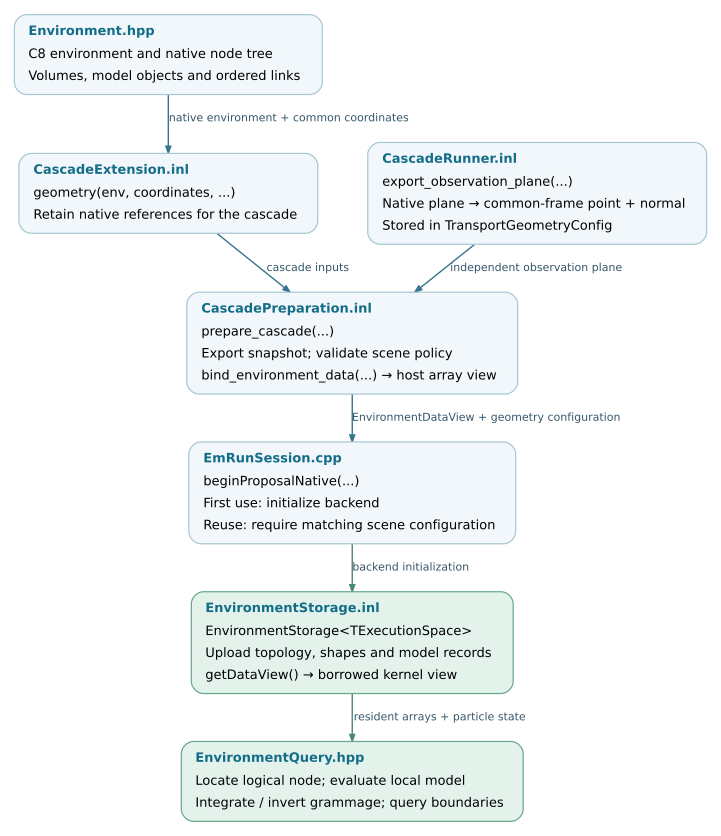

Environment and geometry
========================

The application builds a native C8 environment. The Kokkos backend exports
its topology and supported model parameters into numerical records, uploads
them to execution-space memory, and queries those records during transport.
The native scene remains available for C8 tracking and CPU process execution.

This chapter follows that interface from scene construction to device queries.
It distinguishes support in the environment representation from the more
restricted combinations accepted by each application and physics backend.

.. note::

   Source baseline: `d5297c43
   <https://github.com/BossL668/CORSIKA8-kokkos/tree/d5297c43c041a22b43c65c322d9b51bc7ec8e397>`_.
   The documented production path uses the exported environment tree.
   Legacy sphere-layer and convex-polyhedron compatibility paths are outside
   this chapter's interface contract.

Representation and responsibilities
-----------------------------------

.. list-table::
   :header-rows: 1
   :widths: 30 35 35

   * - Layer
     - Representation
     - Responsibility
   * - Native C8 scene
     - ``Environment``, ``VolumeTreeNode``, volumes and model objects.
     - Scene construction, native tracking and process interfaces.
   * - Host snapshot
     - ``EnvironmentTopology`` and ``EnvironmentSnapshot``.
     - Preserve ordered node relationships; export shapes and model parameters
       in one coordinate system.
   * - Backend storage
     - ``EnvironmentStorage<TExecutionSpace>``.
     - Own the uploaded arrays in the selected execution space.
   * - Query interface
     - ``EnvironmentView`` or ``EnvironmentBorrowedView``.
     - Read topology and numerical models without calling native host objects.

Scene construction is shared. Device evaluation is explicit: existing host
objects are not passed directly into GPU kernels. Point location follows
C8's search order through a numerical implementation; ordered boundary
selection uses an implementation body shared with the native path.

.. toctree::
   :maxdepth: 1

   environment/export
   environment/queries
   environment/extension

.. _environment-source-organization:

Source organization
-------------------

Public contracts are under ``corsika/kokkos/environment/`` and template
implementations under ``corsika/detail/kokkos/environment/``. Native model
export interfaces remain with the media interfaces they extend.

.. include:: environment/_file-map.txt

.. _environment-validation:

Validation coverage
-------------------

The following source tests cover representation, queries and native-path
comparisons. Their presence is not a claim that every test has run on every
GPU architecture. Tests using ``Kokkos::DefaultExecutionSpace`` exercise the
backend selected by that build; full-shower validation remains a separate
requirement.

.. include:: environment/_checks.txt

.. _environment-data-flow:

Environment data flow
---------------------

The application supplies the native environment and common coordinates through
the cascade integration interface. Preparation exports a host snapshot;
backend initialization uploads its arrays. Transport then accesses the
resident representation. The native-node mapping is retained on the host for
particle transfer, as described in :doc:`particles/conversion`.

   Environment preparation and query interfaces. The observation plane is
   separate from the material tree. Open the SVG to follow links to source.
   :download:`SVG <_static/environment-data-flow.svg>` ·
   :download:`Editable DOT source <_static/environment-data-flow.dot>`.
