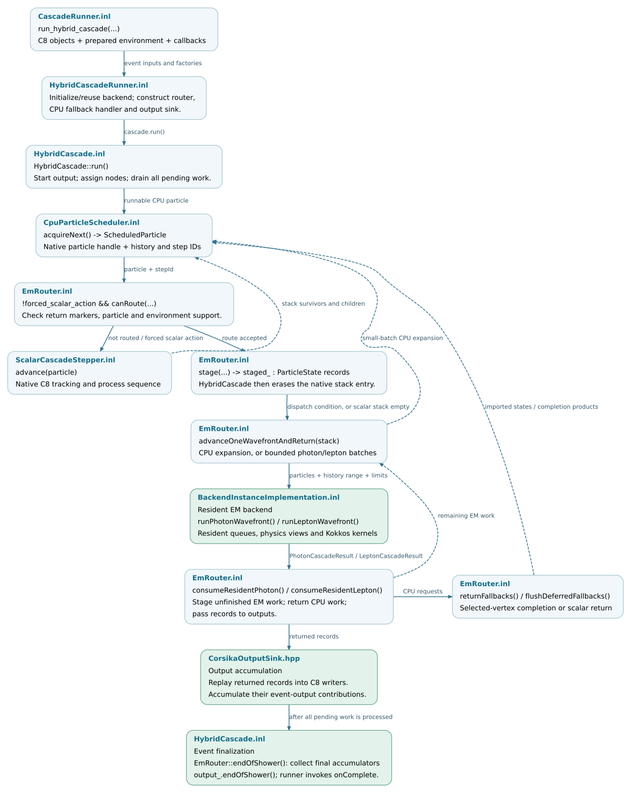

Execution and scheduling
========================

The scheduling layer advances a configured event by combining native C8
particle steps with Kokkos batch execution. ``HybridCascade`` controls the
local event loop, ``EmRouter`` transfers supported particles to the EM backend,
and the backend advances them using the selected Kokkos execution space.
An optional process coordinator distributes subshower work among CPU-prefix
processes and GPU workers.

This chapter documents these components, their interfaces and the conditions
for event completion. The preceding :doc:`application/event-execution` page
describes how the application supplies the event to
``run_hybrid_cascade(...)``.

.. note::

   Source baseline: `d5297c43
   <https://github.com/BossL668/CORSIKA8-kokkos/tree/d5297c43c041a22b43c65c322d9b51bc7ec8e397>`_.
   The execution flow below describes ``kokkos-proposal`` with the standard
   resident EM backend. Native C8 execution uses ``Cascade::run()``, as
   described in :doc:`application/event-execution`. The EGS4 backend and optional
   independent-subshower execution have additional scheduling paths outside
   the scope of this chapter.

.. _two-levels-of-scheduling:

Scheduling hierarchy
--------------------

.. list-table::
   :header-rows: 1
   :widths: 24 38 38

   * - Level
     - Responsible code
     - Scheduling responsibility
   * - Host event loop
     - ``HybridCascade``, ``CpuParticleScheduler`` and ``EmRouter``
     - Select a runnable stack particle, execute a scalar step or stage it for
       the backend, and process returned work.
   * - Backend batch execution
     - ``BackendInstanceImplementation<TExecutionSpace>`` and the resident
       photon/lepton loops
     - Advance supported particles in batches using Kokkos kernels on CPU
       threads or a GPU.
   * - Process coordination
     - ``coordinator::run(...)`` and its worker pool
     - Assign static subshower roots to worker processes and merge their
       outputs. Each GPU worker uses the local event loop and backend.

An OpenMP execution space parallelizes backend kernels across CPU threads.
CPU-prefix parallelism distributes the initial shower work among separate
processes. Their thread and process counts are configured independently.

Execution terminology
---------------------

.. list-table::
   :header-rows: 1
   :widths: 24 76

   * - Term
     - Meaning in this chapter
   * - Batch
     - A group of particle states supplied to, or processed by, the backend.
   * - Transport wavefront
     - The active particle set in one iteration of a resident transport loop.
       Particles retain their own step lengths and simulation times. One
       iteration can involve several kernel launches.
   * - Resident state
     - Particle queues, workspaces or accumulators retained in the backend's
       execution-space memory between calls.
   * - Frontier and root
     - A frontier is a serialized list of particle states from which worker
       processes continue the shower. Each listed particle is a subshower root.
   * - Worker
     - A separate application process assigned CPU-prefix or GPU work. In the
       GPU phase, the coordinator assigns one worker to each selected GPU.

One router call can execute several transport wavefronts before returning.
Batch size, transport-wavefront count and GPU thread-block size describe
different levels of execution.

.. toctree::
   :maxdepth: 1

   execution/hybrid-loop
   execution/batches
   execution/coordinator

.. raw:: html

   

.. _execution-source-files:

Source organization
-------------------

The trees below select the files used in this chapter. Public declarations are
under ``corsika/kokkos/``, template implementations under
``corsika/detail/kokkos/`` and compiled implementations under ``src/kokkos/``.
Click a filename to open the pinned source.

.. include:: execution/_file-map.txt

.. _where-this-chapter-hands-off:

Related modules
---------------

* Particle conversion uses ``particle_transfer::to_device_state(...)`` and
  ``import_particle(...)`` to translate particle state, units, coordinates and
  identity. This interface belongs to :doc:`particles`.
* ``run_photon_cascade(...)`` and ``run_lepton_cascade(...)`` are the entry
  points to the resident transport loops. Their numerical physics kernels
  belong to :doc:`transport`.
* Transport records and CPU-produced tracks reach output writers and radio
  accumulators. Track projection and waveform accumulation belong to
  :doc:`radio`.

.. _maintenance-and-existing-checks:

Validation coverage
-------------------

The following tests cover scheduling and worker-session contracts. Changes to
these interfaces should preserve particle identity, queue accounting, output
contributions and the configured random-stream policy. Full-shower physics and
performance comparisons require separate validation.

.. include:: execution/_checks.txt

.. _execution-data-flow:
.. _from-the-application-handoff-to-particle-execution:

Control and data flow
---------------------

``HybridCascadeRunner.inl`` constructs the router, CPU-fallback handler and
output sink for each event. The backend session and its allocated resources
can persist across events. ``HybridCascade::run()`` advances the event through
scalar steps and router calls, then finalizes output after all pending work
has been processed. The :doc:`execution/hybrid-loop` page describes this
sequence in detail.

   Solid arrows indicate calls and transfers; dashed arrows indicate returned
   work. The loop continues while the CPU scheduler, router or deferred
   interactions have pending work. Source links are available in the full-size
   SVG.
   :download:`SVG <_static/execution-data-flow.svg>` ·
   :download:`Editable DOT source <_static/execution-data-flow.dot>`.
