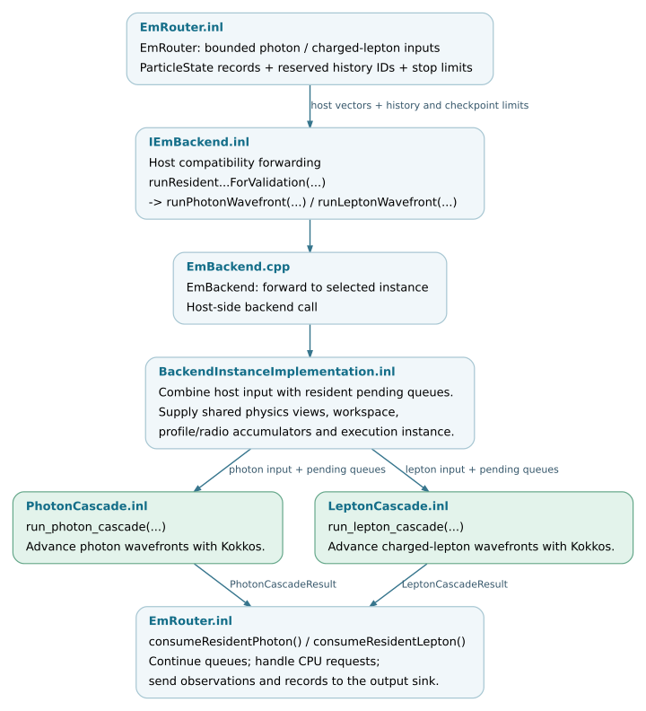

.. _batches-checkpoints-and-cpu-returns:

Batch execution and CPU return paths
====================================

``EmRouter::advanceOneWavefrontAndReturn(stack)`` submits staged particles to
the resident EM backend and processes its results. A single call can advance
several transport wavefronts. Its return value counts CPU returns and
reaction-completion notifications that require node refresh; it is not a
particle-step or kernel-launch count. Transport steps and generated particles
are recorded separately in the result objects and backend statistics.

A checkpoint returns control to the caller while preserving unfinished work
in result records or resident queues. The caller can then resume that work
in a later batch.

Dispatch thresholds and capacity
--------------------------------

The standard router first checks whether a small staged batch should receive
further scalar steps. For backend dispatch, it limits the input to the
advertised capacity, retains excess states in ``staged_`` and separates photons
from charged leptons. It processes the photon batch before the charged-lepton
batch. Both calls can also consume states already held in resident queues.

.. list-table::
   :header-rows: 1
   :widths: 32 68

   * - Control
     - Scheduling effect
   * - ``minimumBatchSize()``
     - A particle-count threshold used by host dispatch and resident-loop
       checkpoints. The small-batch checkpoint applies after at least one
       wavefront; other limits can stop a call earlier. Forced dispatch and
       pending resident work allow execution below this threshold.
   * - Maximum resident input / photon / lepton sizes
     - Capacity limits used to split host input and reserve workspace. An input
       that exceeds the limit remains queued for later processing.
   * - ``maximumWavefronts`` and history-ID limits
     - Limits on iterations and secondary-particle identities within one
       backend call. The standard router requests up to 16 photon wavefronts
       or 1024 lepton wavefronts. The lepton call supplies an exclusive upper
       bound on the reserved history-ID range.
   * - Static frontier import block
     - Limits roots imported from a coordinator-produced file into an empty
       local stack. It is independent of the resident batch capacity; see
       :ref:`execution-frontier-import`.

These controls govern the amount of particle work submitted or retained.
Execution policies inside the transport kernels separately determine the
mapping of particle indices to threads and thread blocks.

.. _calling-the-backend:

Backend interface and execution
-------------------------------

The photon call in ``EmRouter.inl`` is:

.. literalinclude:: ../../../corsika/detail/kokkos/scheduling/EmRouter.inl
   :language: cpp
   :start-at: auto result = backend_.runResidentPhotonCascadeForValidation(
   :end-at: photons, firstHistory, ResidentPhotonWavefronts, backend_.minimumBatchSize());
   :lineno-match:

The charged-lepton call additionally supplies an exclusive history-ID limit:

.. literalinclude:: ../../../corsika/detail/kokkos/scheduling/EmRouter.inl
   :language: cpp
   :start-at: auto result = backend_.runResidentLeptonCascadeForValidation(
   :end-at: backend_.minimumBatchSize());
   :lineno-match:

The production router uses the compatibility methods whose names end in
``ForValidation``. ``IEmBackend.inl`` forwards them to ``runPhotonWavefront``
and ``runLeptonWavefront``. This interface dispatch executes on the host;
the particle kernels use the selected execution-space implementation.

``EmBackend.cpp`` forwards to the selected backend instance.
``BackendInstanceImplementation<TExecutionSpace>`` combines the supplied
``std::vector<ParticleState>`` with pending resident input, supplies shared
physics views, workspaces and accumulators, and calls ``run_photon_cascade``
or ``run_lepton_cascade``. These templates use the selected Kokkos execution
space, including OpenMP, CUDA or HIP in a matching build.

   The scheduling-to-transport boundary. Pending queues and shared workspaces
   can remain in the execution space between calls. Open the SVG for source links.
   :download:`SVG <../_static/execution-backend-flow.svg>` ·
   :download:`Editable DOT source <../_static/execution-backend-flow.dot>`.

.. _returned-data-and-its-consumers:

Result contracts
----------------

The calls return ``PhotonCascadeResult`` or ``LeptonCascadeResult`` by value.
``consumeResidentPhoton`` and ``consumeResidentLepton`` handle these records:

.. list-table::
   :header-rows: 1
   :widths: 38 62

   * - Returned data
     - Processing responsibility
   * - Remaining photons or leptons; generated particles
     - Re-enter host staging when returned. With resident cross-species queues
       enabled, eligible generated particles stay in device-accessible storage
       instead; they must not also be imported as returned children.
   * - ``fallbackEvents_``
     - ``returnFallbacks(...)`` either queues a specified CPU completion or
       returns the particle for a scalar step, subject to the configured error
       policy.
   * - ``cpuSpillParticles_``
     - ``returnMemorySpills(...)`` applies the required native cut handling
       and restores unfinished states to the native stack for scalar processing.
   * - Lepton ``decayCandidates_``
     - ``returnForcedDecays(...)`` marks the corresponding scalar step to
       execute a decay.
   * - Step, final-state, projected-step and observation records
     - Router recording functions pass the required contributions to
       ``CorsikaOutputSink``. Device-owned profile contributions are accumulated
       on their device path and must not be counted again on host replay.
   * - Checkpoint flags and counters
     - Record small batches, workspace limits or exhausted history-ID ranges.
       They describe the end of this backend call, while the event can retain
       active particles elsewhere.

.. _three-different-reasons-to-return-to-the-cpu:

CPU return policies
-------------------

CPU returns serve distinct scheduling and physics requirements. Here a CPU
return means resuming the native C8 scalar path, including when the backend
uses OpenMP. The request type determines how the state is resumed.

Small-batch scalar expansion
~~~~~~~~~~~~~~~~~~~~~~~~~~~~

When staging is below threshold and no resident work is pending, the router
can return those particles to the C8 stack for further scalar steps. This path
also requires that no deferred reaction batch or forced-dispatch condition
takes precedence. A history/step marker directs the next scheduling attempt to
the scalar stepper. A limit on consecutive expansion rounds and a check for
unchanged particle state can trigger backend dispatch even below threshold.

Selected-interaction completion
~~~~~~~~~~~~~~~~~~~~~~~~~~~~~~~

The standard path stores requests accepted by
``ProposalCpuFallbackHandler::canHandle(...)`` in ``deferredFallbackEvents_``.
These requests preserve the particle state and the selected interaction.
After host staging and resident queues are drained, ``flushDeferredFallbacks``
calls ``handle(stack, event)`` to complete the corresponding vertices on the
CPU. Eligible products can then return to the backend. A dedicated flag sends
the resulting staged batch to backend execution without another scalar
expansion cycle.

Other scalar returns
~~~~~~~~~~~~~~~~~~~~

Generic fallback states, decay candidates and memory spills use separate
history/step markers. A decay marker forces the next scalar step to execute
the pending decay. Generic fallback and spill markers allow the particle to
receive a scalar step before routing is reconsidered.

For a fallback request that no specified-reaction handler accepts, enabling
``failOnUnexpectedFallback`` rejects reasons outside the permitted set:
``UnsupportedParticle``, ``UnsupportedMedium`` and ``UnsupportedGeometry``.
Thus an unexpected numerical failure can abort the event, while a permitted
capability return continues through scalar transport. Small-batch expansion
is a scheduling decision independent of these reaction capabilities.

Maintenance requirements
------------------------

Changes to a return record must update both its backend producer and router
consumer. Each active particle needs exactly one continuation path, each
selected interaction must complete once, and each output contribution must
be accumulated once. Resident cross-species retention, host staging and CPU
returns must preserve these invariants.
