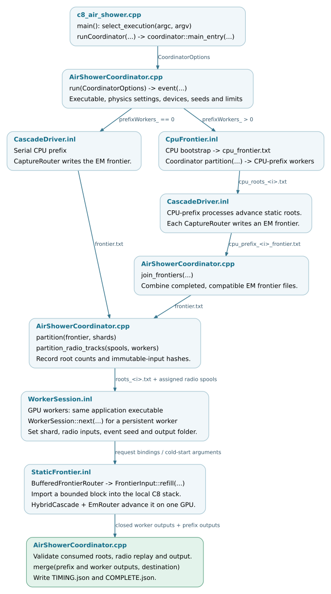

Parallel prefixes and GPU workers
=================================

The coordinator organizes processes around the local execution described in
:doc:`hybrid-loop`. It partitions a shower into static root lists, starts the
native application in the required worker roles and merges their closed
outputs. It does not run particle kernels in the parent coordinator process.

Entry and configuration
-----------------------

The application's early ``select_execution(argc, argv)`` branch enters
``coordinator::main_entry(...)`` when coordinated execution is requested.
``main_entry`` parses ``CoordinatorOptions`` and calls ``run(options)``.
The options include the worker executable, physics arguments, selected devices,
event count, seed, prefix-worker count, split energies, memory fraction and
timeout. It returns a process exit status; ``run`` writes campaign/event records
and returns ``void`` or throws on failure.

Multiple selected GPUs or an explicit ``--prefix-workers`` option trigger
coordinator selection. The ordinary direct single-GPU/OpenMP path stays in
``main``. A coordinated shower can also use one GPU with a parallel CPU prefix.
The current parallel-prefix and persistent-worker paths require
``kokkos-proposal``; selecting an arbitrary EM backend does not enable them.

.. _execution-coordinator-flow:

Follow one coordinated event
----------------------------

   Files cross process boundaries; each GPU worker reconstructs its local C8
   objects and uses the hybrid event loop. Arrow labels name the transferred
   data. Open the full-size SVG for source links.
   :download:`SVG <../_static/execution-coordinator-flow.svg>` ·
   :download:`Editable DOT source <../_static/execution-coordinator-flow.dot>`.

1. **Produce a frontier.** With zero prefix workers, one CPU prefix advances
   the primary and writes ``frontier.txt`` through the capture-router path.
   With a parallel prefix, a bootstrap first writes ``cpu_frontier.txt``;
   ``partition(...)`` assigns those roots to CPU-prefix processes. Each process
   advances its roots with the native C8 path and exports an EM frontier.
   ``join_frontiers(...)`` combines those compatible, closed frontier files.
2. **Assign GPU work.** ``partition(frontier, shards)`` assigns each root once
   to a static GPU shard and returns JSON audit data including counts and
   hashes. ``partition_radio_tracks(...)`` separately assigns prefix radio-track
   spools to workers. A worker may receive radio work even when its particle
   shard is empty.
3. **Advance the shards.** Each worker is a process using the same native
   executable. Its visibility environment exposes its assigned GPU, selected
   locally as device zero. It reads the shard and radio inputs, runs the local
   hybrid cascade and writes its event output.
4. **Validate and merge.** The coordinator checks process status, required
   outputs, consumed-root counts and immutable input hashes. It then calls
   ``merge(parts, destination)`` with the prefix and worker output directories
   in order. Profiles and fields are combined and particle records are
   concatenated. ``COMPLETE.json`` is written after these steps; exceptions
   produce ``INCOMPLETE.json``.

This is a static decomposition. Workers do not continuously exchange live
particles or steal subshowers from one another. Equal root counts also do not
guarantee equal processing times. The CPU-prefix worker count and GPU worker
count are separate configuration values.

.. _execution-frontier-import:

Import roots in bounded blocks
------------------------------

Inside a worker, ``CascadeParticleInput`` binds a ``FrontierInput`` to the event.
``BufferedFrontierRouter`` wraps the ordinary router and feeds another block
only when its existing work has drained:

.. literalinclude:: ../../../corsika/detail/kokkos/scheduling/StaticFrontier.inl
   :language: cpp
   :start-at: if (TBaseRouter::pending()) return TBaseRouter::advanceOneWavefrontAndReturn(stack);
   :end-at: return 0;
   :lineno-match:

``FrontierInput::refill(stack, cs, limit, topology)`` reads numerical particle
records, validates the environment and history identities, then imports them
into the empty native stack. It returns the number of imported roots.
The wrapper's ``pending()`` also includes unread input, so an empty local EM
queue cannot finish the shower while roots remain in the file.

``C8_STATIC_FRONTIER_IMPORT_BATCH`` overrides the import block, with an accepted
range of 1--65536 roots. Without the override, the wrapper derives it from
``minimumBatchSize()``, clamped to that range. This controls host input feeding;
it does not change the number of GPU workers or directly set a kernel block
size. ``FRONTIER_FEED.json`` records consumed roots and import batches.

Reuse across events
-------------------

``coordinator::run`` keeps a ``WorkerPool`` for the campaign. Its current reuse
condition is included directly from the implementation:

.. literalinclude:: ../../../src/kokkos/scheduling/AirShowerCoordinator.cpp
   :language: cpp
   :start-at: WorkerPool pool;
   :end-at: o.persistentWorkers_ && o.events_ > 1 && o.emBackend_ == "kokkos-proposal";
   :lineno-match:

The pool starts after the first event's CPU prefix, not ahead of it. Workers
publish ``READY.json`` after their model setup. GPU initialization occurs on
the first real request; subsequent requests reuse the session. Later prefixes
run while those worker processes remain alive, but they are not a pipeline of
concurrently advancing events.

.. list-table::
   :header-rows: 1
   :widths: 33 67

   * - Control/data boundary
     - What crosses it
   * - Coordinator to ``WorkerSession::next(...)``
     - ``request_<n>.json`` supplies the seed, event folder, frontier path,
       worker ID and radio-input paths, or an explicit skip request.
   * - Worker session to application objects
     - ``backend.assignWorkerInput(...)`` changes input bindings;
       ``application.setWorkerSeed(...)`` sets the event seed used by device
       sampling and selected CPU replay. Output libraries and event counters
       are reset for the new event.
   * - Session to EM backend
     - ``EmRunSession::beginProposalNative(...)`` initializes on first use and
       calls ``beginShower(...)`` on reuse. Physics tables and allocated
       resources persist; per-shower state is reset.
   * - Worker to coordinator
     - ``done_<n>.json`` reports completion or a skipped request. The coordinator
       waits for all assigned workers before validating and merging that event.

Native CPU random streams continue across requests, including streams retained
by physics models. The session restores per-event decay flags and histograms
without rewinding those streams. Device sampling uses the request seed and
particle history. Therefore a persistent campaign is not promised to reproduce
the values from launching an isolated fresh process for every event; validation
must state which random-stream policy is being compared.

Completion and timing records
-----------------------------

``TIMING.json`` separates event wall time, the CPU-prefix phase, merge time and
process/request records. Persistent-worker records must be read as requests,
not as the entire lifetime of the worker. These wall times do not by themselves
measure GPU kernel activity or CPU core-hours. See :doc:`../usage/outputs` for
the output conventions.

``COMPLETE.json`` establishes execution and output completion. Statistical
physics agreement and performance acceptance require their own comparison;
the coordinator's file and counter checks do not establish either.
