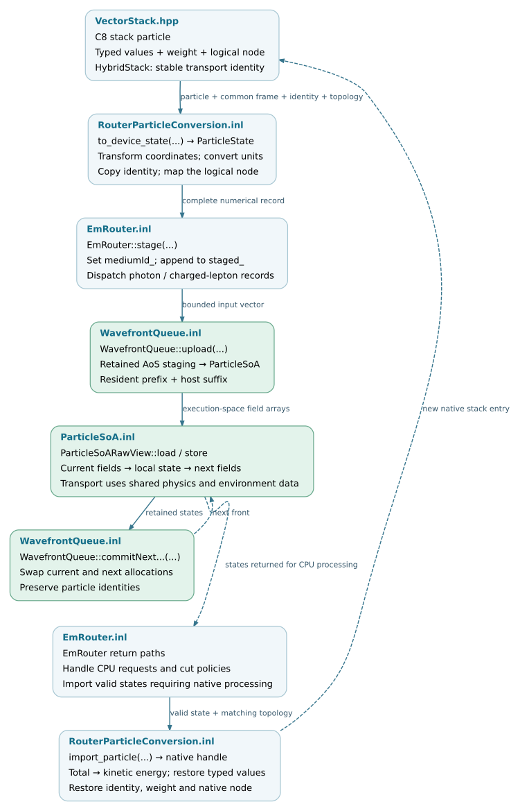

Particle data and state
=======================

The particle-data layer transfers C8 particle values into the numerical
representation used by the Kokkos backend and restores returned particles to
the native stack. Its contract includes energy definitions, units, coordinates,
statistical weights, transport identities and logical environment nodes.

The :doc:`execution` chapter describes when particles are routed or returned.
This chapter describes the data carried by those operations, the conversion
interfaces and the storage used during batch execution.

.. note::

   Source baseline: `d5297c43
   <https://github.com/BossL668/CORSIKA8-kokkos/tree/d5297c43c041a22b43c65c322d9b51bc7ec8e397>`_.
   The production transfer path documented here is the standard resident EM
   backend. The general value-conversion helpers have a separate, narrower
   contract; they are not wrappers called by the production router.

Data representations
--------------------

.. list-table::
   :header-rows: 1
   :widths: 28 36 36

   * - Representation
     - Contents
     - Role
   * - C8 particle interface and stack
     - Typed physical quantities, coordinate-aware geometry, weight and node
       extensions; transport identities in ``setup::HybridStack``.
     - Native tracking, process execution and output interfaces.
   * - ``ParticleState``
     - Numerical values in a common coordinate system, integer identifiers
       and compatibility tags.
     - A value record used in host staging, transfers and local kernel work.
   * - ``ParticleSoA<TMemorySpace>``
     - Kokkos arrays storing the fields of many ``ParticleState`` records.
     - Batch storage in the execution space's memory.
   * - ``ParticleSoARawView``
     - Borrowed array addresses and strides, with device-callable
       ``load`` and ``store`` methods.
     - Kernel access to an existing allocation; no ownership or copy.

C8's ``VectorStackImpl`` already stores particle fields in separate vectors.
The Kokkos representation adds explicit numerical conventions and
execution-space storage; it does not introduce field-based storage to an
otherwise object-per-particle stack.

.. toctree::
   :maxdepth: 1

   particles/representation
   particles/conversion
   particles/storage

.. _particles-source-organization:

Source organization
-------------------

The following files define the data and conversion contracts. Public
declarations reside under ``corsika/kokkos/``; their template implementations
reside under ``corsika/detail/kokkos/``. The links open the checked source
revision.

.. include:: particles/_file-map.txt

.. _particles-validation:

Validation coverage
-------------------

The tests below exercise data transfer and storage contracts. They are not a
substitute for full-shower physics or performance validation. In particular,
converting a hadron or a nucleus into a numerical record does not establish
that the EM backend can transport it.

.. include:: particles/_checks.txt

.. _particles-data-flow:

Particle-state data flow
------------------------

Host conversion produces records before queue upload. Device kernels then
load and store numerical fields without invoking the C8 particle interface.
Surviving particles can remain in backend memory across transport wavefronts;
only states that require host processing cross the return boundary. Particle
tracks and output contributions use separate result records, described in
:ref:`returned-data-and-its-consumers`.

   Data conversion and storage boundaries. The return arrow applies to
   particles resumed on the native path, not to every backend step. Open the
   SVG for links to the corresponding implementation.
   :download:`SVG <_static/particles-data-flow.svg>` ·
   :download:`Editable DOT source <_static/particles-data-flow.dot>`.
