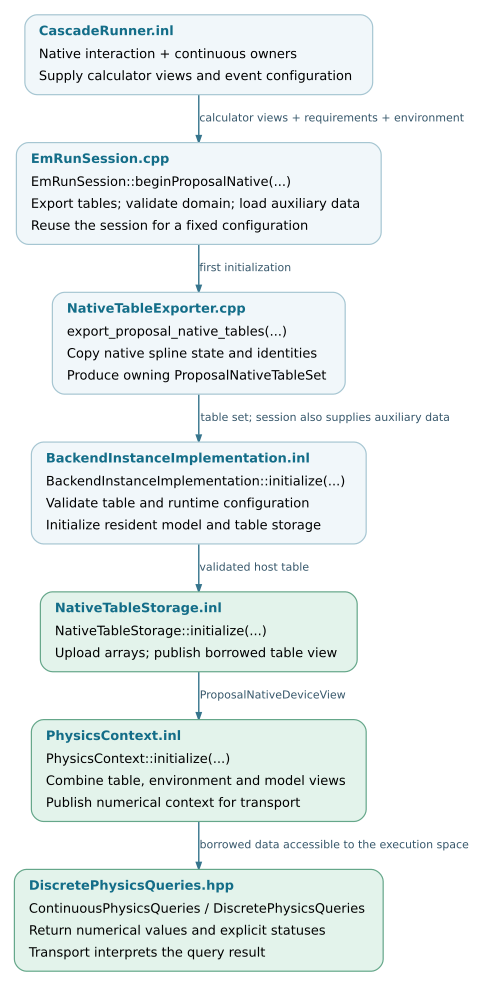

Physics models and table preparation
====================================

The native C8 PROPOSAL modules own the configured calculators. The Kokkos
integration exports their interpolation state, validates its format and
physical coverage, and uploads it into backend-owned arrays. Transport queries
those arrays through device-callable interpolation and inverse routines.

This chapter describes model preparation, table representation and the
interfaces consumed by transport. It complements :doc:`environment`, which
describes the geometry and material parameters supplied to the same backend.

.. note::

   Source baseline: `d5297c43
   <https://github.com/BossL668/CORSIKA8-kokkos/tree/d5297c43c041a22b43c65c322d9b51bc7ec8e397>`_.
   This chapter covers the ``proposal-native`` data path used by the standard
   Kokkos EM backend. EGS4, hadronic generators and radio propagation data have
   separate preparation contracts. Exporting PROPOSAL data does not make its
   library objects device-callable.

Data preparation layers
-----------------------

.. list-table::
   :header-rows: 1
   :widths: 29 35 36

   * - Component
     - Input
     - Result and responsibility
   * - C8 PROPOSAL modules
     - Selected particle definitions, medium composition, models and cuts.
     - Native calculators, including their interpolation tables and CPU
       interaction interfaces.
   * - ``export_proposal_native_tables``
     - Read-only views of the native interaction and continuous calculators.
     - An owning ``ProposalNativeTableSet`` with interpolation records,
       metadata, ordering information and a content hash.
   * - ``NativeTableStorage``
     - A validated table set and optional allocation budget.
     - Arrays in the selected execution space and a borrowed
       ``ProposalNativeDeviceView``.
   * - Auxiliary model preparation
     - Configured material and model information.
     - Moliere and LPM parameters and derived support data; these are distinct
       from the native rate, loss and range tables.
   * - ``PhysicsContext``
     - Physics views, auxiliary model data, environment, geometry and event
       configuration.
     - The borrowed numerical context consumed by resident transport kernels.

Three contracts are particularly important for maintenance. The distance
sampler uses a separate total-rate interpolant, whereas channel selection
uses an ordered sum of individual columns. A cumulative-rate table is not
itself a normalized CDF. Finally, a process can have a rate and energy-loss
table while still lacking the data needed to construct its complete final
state.

.. toctree::
   :maxdepth: 1

   physics-data/preparation
   physics-data/storage
   physics-data/contracts

.. _physics-data-source-organization:

Source organization
-------------------

The host exporter is separate from the table records, execution-space storage
and numerical query functions. Public declarations, template implementations
and compiled implementation files are listed below with links to the checked
revision.

.. include:: physics-data/_file-map.txt

.. _physics-data-validation:

Validation coverage
-------------------

The following tests cover export, storage, queries and CPU completion. Their
presence documents existing coverage; it does not imply that all tests have
run on every supported device. Execution-space tests use the backend selected
by their build. Full-shower physics and timing comparisons remain separate
validation steps.

.. include:: physics-data/_checks.txt

.. _physics-data-flow:

Preparation and query flow
--------------------------

The session initializes the resident physics data before transport. Repeated
queries use memory already owned by the backend. CPU interaction completion
retains access to the native model and selected-vertex information; its
dispatch policy is documented in :doc:`physics-data/contracts`.

   Source-level preparation and consumption. Arrays are retained across event
   resets under a fixed physics configuration. Open the SVG for source links.
   :download:`SVG <_static/physics-data-flow.svg>` ·
   :download:`Editable DOT source <_static/physics-data-flow.dot>`.
