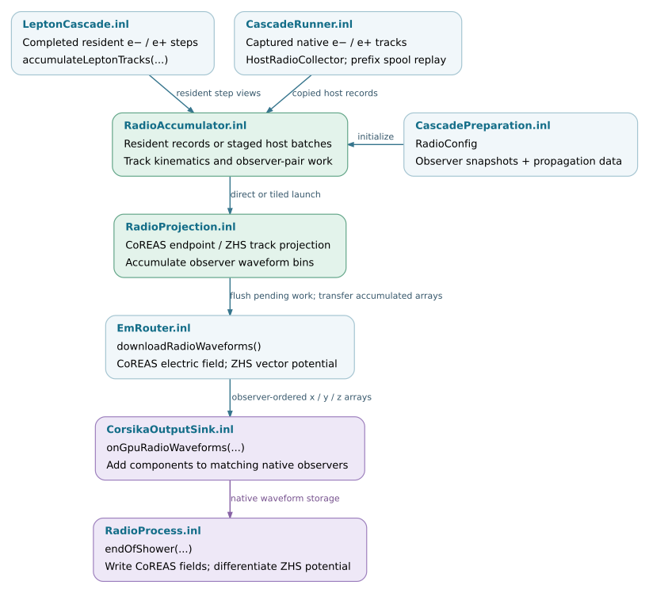

Radio calculation
=================

Radio calculation converts completed charged-particle tracks into signals at
specified observer positions. Transport determines the tracks; the radio
implementation applies an emission formalism and propagation model, then
accumulates the contributions in the observer's time or frequency grid.

This chapter follows the inputs, numerical execution and output interfaces.
Particle transport is described in :doc:`transport`; event routing and
multi-process coordination are described in :doc:`execution`.

.. note::

   Source baseline: `d5297c43
   <https://github.com/BossL668/CORSIKA8-kokkos/tree/d5297c43c041a22b43c65c322d9b51bc7ec8e397>`_.
   The ordinary atmosphere/homogeneous-medium accumulator and the firn radio
   implementations have distinct propagation and output contracts. Selecting
   a Kokkos execution space does not select a propagation model or establish
   its suitability for a particular environment.

Component responsibilities
--------------------------

.. list-table::
   :header-rows: 1
   :widths: 25 35 40

   * - Component
     - Input
     - Responsibility and output
   * - Configuration builders
     - C8 environment or optical model, observers and enabled algorithms.
     - Numerical propagation parameters and observer snapshots. No track
       projection occurs during this conversion.
   * - Track adapters
     - Completed resident steps or native C8 track segments.
     - Endpoint records in compatible units and coordinates, collected once
       for the requested radio algorithms.
   * - Projection kernels
     - Track kinematics, observers and propagation data.
     - CoREAS endpoint contributions or ZHS track contributions, deposited
       in the configured waveform buffers.
   * - Accumulator
     - Track batches and persistent observer storage.
     - Schedules work, sums contributions and transfers completed waveforms.
   * - Output bridge
     - Completed waveforms in observer order.
     - Adds them to native C8 observers and preserves the native output
       convention, including ZHS differentiation.
   * - Firn propagation and emission
     - Local optical profile, observers, tracks and selected ray/table model.
     - Dedicated geometrical-optics or full-wave calculation. See
       :doc:`radio/propagation` for supported combinations and output forms.

.. toctree::
   :maxdepth: 1

   radio/inputs
   radio/accumulation
   radio/propagation

Application integration
-----------------------

In the standard ``kokkos-proposal`` runner, ``prepare_cascade`` builds the
ordinary radio configuration when the scene is not firn, the requested radio
backend is ``kokkos`` and the CoREAS detector collection is nonempty. The
atmospheric builder obtains propagation and observer data from the C8 scene;
the homogeneous builder receives the uniform-medium parameters and coordinate
system. The ZHS enable flag is retained separately. This is an application
selection rule, not a restriction of every lower-level radio interface.
See `CascadePreparation.inl`_.

`CascadeRunner.inl`_ attaches a ``ScopedRadioTrackSink`` for native C8 tracks
and connects it through ``HostRadioCollector`` and a borrowed backend adapter.
Resident transport reaches the same ordinary accumulator directly through
``accumulateLeptonTracks`` in `LeptonCascade.inl`_. A track captured on the
native path must not also be projected by both native radio processes or
replayed a second time. :doc:`radio/inputs` documents the capture and prefix
spool contracts.

The EGS4 application session also prepares an ordinary Kokkos radio
configuration through `Egs4RunSession.inl`_. Firn instead uses a dedicated
radio process and accumulator connection. These are separate application
paths; the standard runner's selection condition should not be generalized
to all available EM and radio combinations.

Waveform finalization and native output
---------------------------------------

At event finalization, ``EmRouter`` requests
``downloadRadioWaveforms()``. The backend completes pending projection,
including any partially filled host track batch.
``CorsikaOutputSink::onGpuRadioWaveforms`` checks observer counts and adds each
returned component to the corresponding native observer. These interface
names contain ``Gpu`` for historical reasons; the ordinary Kokkos accumulator
also has a CPU execution-space implementation.

``RadioWaveforms`` deliberately preserves two different quantities:

* ``coreas_`` contains electric-field samples.
* ``zhs_`` contains vector-potential samples. They are not yet the final
  electric-field waveform.

The native ``RadioProcess::endOfShower`` writes CoREAS field samples directly.
For time-domain ZHS, it computes the negative adjacent-sample difference,
multiplies by the sample rate and writes the result at the bin midpoint:

.. literalinclude:: ../../corsika/detail/modules/radio/RadioProcess.inl
   :language: cpp
   :lines: 213-218
   :lineno-match:

This conversion belongs to the existing C8 output path. Treating the downloaded
ZHS array as an electric field, differentiating it twice, or adding it to a
collection with a different observer order would change the signal. The
contracts are defined in `RadioWaveforms.hpp`_, `EmRouter.inl`_,
`CorsikaOutputSink.inl`_ and `RadioProcess.inl`_. The dedicated firn output
formats are described separately in :doc:`radio/propagation`.

Multi-process output merging belongs to the coordinator described in
:doc:`execution/coordinator`. It validates completed worker outputs before
combining them. The ordinary radio library also provides a fixed-point merge
for exactly two cooperative endpoints; that interface is not the general
multi-GPU process merger. Its compatibility and overflow rules are documented
in :doc:`radio/accumulation`.

Source organization
-------------------

Public interfaces and data types reside under ``corsika/kokkos/radio``;
inline implementations reside under ``corsika/detail/kokkos/radio``.
Compiled firn implementations reside under ``src/kokkos/radio/firn``.
The application and output adapters connect these components to native C8
objects without putting application orchestration into the numerical kernels.

.. include:: radio/_file-map.txt

Validation coverage
-------------------

Validation must distinguish fixed-track numerical comparisons, lifecycle
checks and full-shower physics comparisons. A match to a retained production
implementation establishes compatibility for those inputs; it does not by
itself establish independent physical accuracy. Different propagation models
also require matched optical profiles, observer geometry and signal
conventions before their waveforms can be compared.

.. include:: radio/_checks.txt

The listed tests exist in the pinned revision. This chapter is an interface
and implementation reference, not a record of tests executed on every device.
The subpages identify additional assumptions and backend-specific coverage.

Track-to-output data flow
-------------------------

The diagram shows the ordinary atmosphere/homogeneous-medium path. Both
resident and native tracks reach one accumulator, while the application
supplies compatible observer and propagation data. Firn uses the distinct
interfaces described in :doc:`radio/propagation`.

tputSink to native observers and RadioProcess output.
   :width: 100%
   :target: _static/radio-data-flow.svg

   Track submission, projection and output in the ordinary radio path. Open
   the SVG for links to the checked source revision.
   :download:`SVG <_static/radio-data-flow.svg>` ·
   :download:`Editable DOT source <_static/radio-data-flow.dot>`.

.. _CascadePreparation.inl: https://github.com/BossL668/CORSIKA8-kokkos/blob/d5297c43c041a22b43c65c322d9b51bc7ec8e397/corsika/detail/kokkos/application/cascade/CascadePreparation.inl
.. _CascadeRunner.inl: https://github.com/BossL668/CORSIKA8-kokkos/blob/d5297c43c041a22b43c65c322d9b51bc7ec8e397/corsika/detail/kokkos/application/cascade/CascadeRunner.inl
.. _LeptonCascade.inl: https://github.com/BossL668/CORSIKA8-kokkos/blob/d5297c43c041a22b43c65c322d9b51bc7ec8e397/corsika/detail/kokkos/em/execution/LeptonCascade.inl
.. _Egs4RunSession.inl: https://github.com/BossL668/CORSIKA8-kokkos/blob/d5297c43c041a22b43c65c322d9b51bc7ec8e397/corsika/detail/kokkos/application/cascade/atmosphere/Egs4RunSession.inl
.. _RadioWaveforms.hpp: https://github.com/BossL668/CORSIKA8-kokkos/blob/d5297c43c041a22b43c65c322d9b51bc7ec8e397/corsika/kokkos/radio/RadioWaveforms.hpp
.. _EmRouter.inl: https://github.com/BossL668/CORSIKA8-kokkos/blob/d5297c43c041a22b43c65c322d9b51bc7ec8e397/corsika/detail/kokkos/scheduling/EmRouter.inl
.. _CorsikaOutputSink.inl: https://github.com/BossL668/CORSIKA8-kokkos/blob/d5297c43c041a22b43c65c322d9b51bc7ec8e397/corsika/detail/kokkos/output/CorsikaOutputSink.inl
.. _RadioProcess.inl: https://github.com/BossL668/CORSIKA8-kokkos/blob/d5297c43c041a22b43c65c322d9b51bc7ec8e397/corsika/detail/modules/radio/RadioProcess.inl
