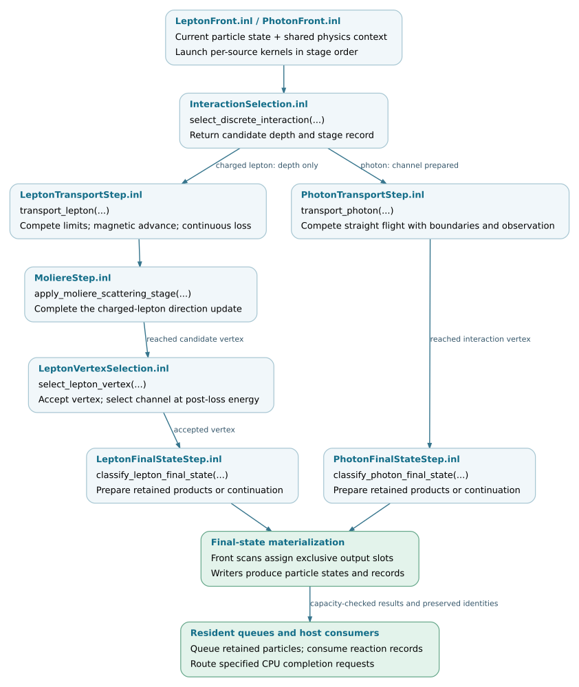

Transport and interaction kernels
=================================

Transport combines sampled interaction depths, environmental limits and
continuous processes to advance a particle. Interaction kernels then construct
the final state at a reached vertex. These numerical functions are separate
from the execution layer that allocates output slots, advances resident queues
and returns work to native C8 modules.

This chapter follows one particle through the standard Kokkos EM path. It
continues from :doc:`physics-data` and :doc:`environment`; the surrounding
batch and event control is described in :doc:`execution`.

.. note::

   Source baseline: `d5297c43
   <https://github.com/BossL668/CORSIKA8-kokkos/tree/d5297c43c041a22b43c65c322d9b51bc7ec8e397>`_.
   The description covers the ``proposal-native`` Kokkos EM implementation.
   Native C8 scalar transport and the EGS4 execution path have separate
   implementations. A shared physics model or table does not imply that these
   paths use the same C++ call chain or random stream.

Stage responsibilities
----------------------

.. list-table::
   :header-rows: 1
   :widths: 27 36 37

   * - Stage
     - Main input
     - Output and responsibility
   * - Candidate sampling
     - Particle state, physics view and random identity.
     - ``InteractionSelectionOutcome`` with a sampled depth, cut or fallback.
       Charged-lepton channel selection remains pending.
   * - Charged-lepton transport
     - Candidate, continuous tables, environment and geometry configuration.
     - ``LeptonTransportRecord`` with endpoints, limiting process and deposits.
       Multiple scattering completes the direction update in a separate stage.
   * - Charged-lepton vertex selection
     - Reached candidate, post-loss energy and retained acceptance draw.
     - Selected process/component and loss fraction, rejected-vertex
       continuation, or specified CPU completion request.
   * - Photon transport
     - Candidate and environment/geometry data.
     - ``PhotonTransportRecord`` at a boundary, observation, cut or interaction.
       Photon flight changes position and time, not energy or direction.
   * - Final-state classification
     - Selected vertex, model parameters, thinning configuration and random identity.
     - Kinematic parameters and retained-child counts, or continuation,
       suppression or fallback. No output queue is allocated here.
   * - Final-state materialization
     - Classification, exclusive output offset and first child history ID.
     - Particle states and records written into caller-provided output slots.

.. toctree::
   :maxdepth: 1

   transport/selection
   transport/lepton-step
   transport/interactions

Kernel execution and shared implementations
-------------------------------------------

``LeptonFront.inl`` launches candidate selection, transport and multiple
scattering as separate kernels on the same execution instance. It then
compacts the interaction candidates in source order and applies vertex and
final-state classification to those candidates. ``PhotonFront.inl`` likewise
separates selection from transport and compacts reached interactions before
final-state classification.

These resident front implementations are the production call sites. The
host-vector adapters such as ``transport_leptons_batch`` and
``transport_photons_batch`` are useful for direct calls and tests, but their
allocation and copy sequence is not the resident shower loop.

OpenMP, CUDA and HIP builds instantiate the same Kokkos numerical functions
for the selected execution space. Kokkos supplies launch, iteration and memory
primitives; the CORSIKA integration supplies the physics and record contracts.
Native C8 scalar modules still have their own transport and PROPOSAL calls.
The shared environment boundary-selection body is one specific common
implementation, described in :doc:`environment/queries`; it does not make
every numerical solver common to the scalar and accelerated paths.

Changing a launch policy is therefore different from changing a physical
step. Kernel changes must preserve the full particle state, random keys,
selected interaction, record ordering and exactly-once output accounting.
Changing a model or solver also requires numerical and physics validation.

Source organization
-------------------

Public headers declare the per-particle interfaces and records. Their inline
implementations reside under ``corsika/detail/kokkos/em``. Resident execution
files connect these functions to the queue and output storage.

.. include:: transport/_file-map.txt

Validation coverage
-------------------

The tests below cover different layers of the step. Many compare against a
retained production reference within the selected execution space. They
establish implementation compatibility for the tested inputs, not independent
physical accuracy or universal bitwise equality between GPU architectures.
Real-table targets require the export-enabled build and its data fixtures.

.. include:: transport/_checks.txt

This map records coverage in the pinned source revision; it is not a test
report. Algorithm or model changes require the relevant executable tests and
an appropriate full-shower validation.

Per-particle execution flow
---------------------------

The diagram follows reached and accepted interaction vertices. Boundary
continuations, cuts, observations, decay candidates and early fallback
requests bypass the later interaction stages and are omitted here. Selecting
a photon channel is not enough to execute its reaction: transport must reach
the candidate vertex first. The surrounding execution layer handles all
returned outcomes and queue checkpoints.

   Numerical step functions and their resident callers. Open the SVG for
   links to the checked source revision.
   :download:`SVG <_static/transport-step-flow.svg>` ·
   :download:`Editable DOT source <_static/transport-step-flow.dot>`.
