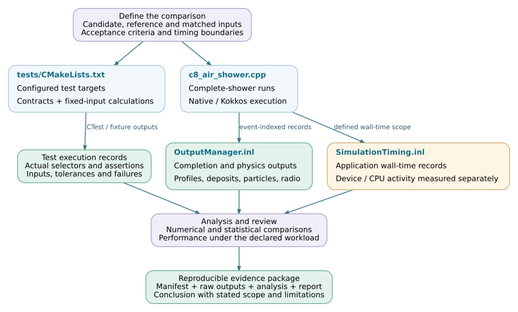

Validation and performance
==========================

Validation establishes that a change preserves the required interfaces,
numerical behavior and physical observables. Performance measurement then
determines its cost under a specified workload and resource configuration.
The required evidence depends on the change: a queue refactor, a numerical
solver and a new physical model need different comparisons.

This chapter connects the repository's executable tests to numerical checks,
complete-shower comparisons and timing reports. It describes how to prepare
and interpret evidence; it does not report a new simulation campaign.

.. note::

   Source baseline: `d5297c43
   <https://github.com/BossL668/CORSIKA8-kokkos/tree/d5297c43c041a22b43c65c322d9b51bc7ec8e397>`_.
   Test registration documents available checks. A passing result also needs
   the tested revision, build, inputs and actual execution record. The
   pinned repository does not supply a universal acceptance threshold for
   every observable or a complete-shower certification for every backend.

Validation levels
-----------------

.. list-table::
   :header-rows: 1
   :widths: 22 39 39

   * - Level
     - Evidence
     - Established scope
   * - Interface and lifecycle
     - Header compilation, argument validation, ownership, queue accounting
       and output-completion tests.
     - The exercised contracts and failure paths. This does not establish
       numerical accuracy or physical distributions.
   * - Numerical component
     - Controlled inputs, specified random draws, reference values and
       documented tolerances.
     - The tested calculation and input range, including identified boundary
       cases. Record whether the reference is independent of the candidate.
   * - Integrated backend
     - Resident transport, material transitions, CPU completion, radio
       accumulation and session-reuse tests.
     - Correct composition and state transfer for the fixtures exercised.
       Synthetic tables may deliberately isolate a contract from cross-section
       accuracy.
   * - Complete shower
     - Matched physical settings, completed events and an ensemble comparison
       of profiles, energy accounting and radio observables.
     - Agreement within the declared statistical and physical scope. Equal
       seeds alone do not establish equal particle histories.
   * - Performance
     - Repeated timings with explicit measurement boundaries, hardware,
       workload, initialization and resource accounting.
     - Cost for that workload and configuration, after the relevant correctness
       checks. A module speedup is not an end-to-end speedup.

.. toctree::
   :maxdepth: 1

   validation/tests
   validation/numerics
   validation/performance

Reference selection
-------------------

Several test fixtures retain an earlier production implementation to detect
changes during reorganization. They are valuable regression references, but
they can share an approximation or defect with the current implementation.
Other fixtures use native C8 objects, real PROPOSAL calculators, analytic
results or deliberately simplified numerical data. State which comparison a
result actually makes.

For example, `testLeptonTransport.cpp`_ compares controlled transport results
with the retained transport reference, whereas `testCpuFallbackPhysics.cpp`_
exercises real CPU reaction calculators. `testMaterialBoundaryStatistics.cpp`_
uses a linear range fixture to isolate actual firn-interface transport and
record accounting; its success is not a validation of physical stopping
power. These tests answer different questions and complement one another.

Use a reference appropriate to the intended claim:

* **Preserving an implementation:** compare fixed inputs and state transitions,
  including failure status and random-state progression where required.
* **Checking a numerical method:** compare residuals and errors with an
  independent result over the supported domain, including relevant tails.
* **Checking physical agreement:** compare matched ensembles and observable
  definitions, with uncertainties and a predefined acceptance criterion.

See :doc:`validation/numerics` for reference tolerances, random-stream policy
and whole-event comparisons.

Change-to-test mapping
----------------------

The following map selects a starting point, not a substitute for reviewing
the dependencies of a particular change. The numerical and execution chapters
contain more detailed test maps.

.. list-table::
   :header-rows: 1
   :widths: 28 37 35

   * - Changed component
     - Initial checks
     - Integration evidence
   * - CLI, runtime or coordinator
     - Configuration errors, device visibility, ownership, worker requests
       and cleanup.
     - Direct/coordinated execution and multi-event reuse with the affected
       backend. See :doc:`backends` and :doc:`execution`.
   * - Particle or environment representation
     - Units, coordinates, history/node identity, host/device conversion,
       containment and boundary ordering.
     - Transport through the affected geometry and materials, including
       observation handling. See :doc:`particles` and :doc:`environment`.
   * - Tables, transport or final states
     - Export/query consistency, solver domain, reaction selection and
       complete handling of device and CPU channels.
     - Deposits, surviving particles, secondary products and profile
       accounting. See :doc:`physics-data` and :doc:`transport`.
   * - Radio projection or accumulation
     - Fixed tracks and observers, emission convention, propagation branches,
       time bins, accumulation and output conversion.
     - Unfiltered waveforms and consistently defined derived observables.
       See :doc:`radio`.
   * - Launch policy, batching or worker reuse
     - Queue counts, complete-state transfer, overflow/continuation paths,
       random-stream policy and output merging.
     - Correctness before timing; include representative batch populations
       and complete events. See :doc:`validation/performance`.

Source organization
-------------------

Paths are relative to the repository root. Tests can be registered from
several directories; a single CTest label does not select all integration
contracts.

.. code-block:: text

   tests/
   ├── CMakeLists.txt                 # Adds framework and optional Kokkos tests
   ├── framework/geometry/            # Native node/boundary references
   ├── application_support/           # CLI, coordinator and binding contracts
   ├── kokkos/
   │   ├── runtime/                   # Runtime ownership and execution primitives
   │   ├── data/                      # Particle data contracts
   │   ├── environment/               # Export, queries and boundary tests
   │   ├── em/                        # Tables, physics and resident execution
   │   ├── scheduling/                # Routing, deferral and scalar state transfer
   │   ├── output/                    # Profile and record accounting
   │   └── radio/                     # Projection, accumulation and propagation
   └── output/                        # Native output and lifecycle tests
   cmake/
   ├── BackendRuntimeContracts.cmake  # Production runtime test registration
   └── BackendExecutionContracts.cmake # Backend and reused-session contracts
   corsika/detail/output/
   └── SimulationTiming.inl           # Application timing boundaries and fields
   src/kokkos/scheduling/
   └── AirShowerCoordinator.cpp       # Completion checks and process timings

The :doc:`validation/tests` page identifies executable targets, registration
conditions and useful selectors. Output file names and event-index conventions
are described in :doc:`usage/outputs`.

Reproducible evidence
---------------------

Keep the configuration, source/build identity, raw results and analysis
together. A plot is a presentation of the evidence, not its replacement.
For each comparison, record:

.. list-table::
   :header-rows: 1
   :widths: 25 75

   * - Record
     - Required context
   * - Implementation
     - Candidate and reference revisions, local patches, dependency/model-data
       versions, build options, compiler and runtime/device identity.
   * - Inputs
     - Complete physics and observer settings, input files and checksums,
       event identifiers, seeds, stream policy and execution configuration.
   * - Execution
     - Requested/completed/failed event counts, logs, exit statuses, backend
       completion records and any exclusions with their reasons.
   * - Analysis
     - Comparison script and revision, units and normalization, statistical
       method, numerical/physical acceptance criteria and measured results.
   * - Timing
     - Clock or profiler, start/end boundaries, cold versus reused events,
       repetitions, instrumentation and actual versus allocated resource time.

The downloadable :download:`comparison manifest template
<_static/validation-manifest.json>` provides a starting structure for these
records. It is a documentation template, not an application-generated schema
or an automated acceptance tool. Null values and empty arrays represent
information that must be supplied; they do not imply a successful check.

Preserve failed and excluded runs in the audit record. Process success and
``COMPLETE.json`` establish completion of the corresponding execution checks,
not statistical agreement. Do not relabel an incomplete or inconclusive
comparison as a passing physics result.

Validation workflow
-------------------

This workflow combines repository tests with a comparison prepared for the
specific change. The links identify source entry points; the numerical and
statistical analysis remains an explicitly recorded part of the validation.

ort.
   :width: 100%
   :target: _static/validation-workflow.svg

   Validation and performance evidence for a reviewed change. The diagram is
   a maintainer workflow, not an automatic application pipeline.
   :download:`SVG <_static/validation-workflow.svg>` ·
   :download:`Editable DOT source <_static/validation-workflow.dot>`.

.. _testLeptonTransport.cpp: https://github.com/BossL668/CORSIKA8-kokkos/blob/d5297c43c041a22b43c65c322d9b51bc7ec8e397/tests/kokkos/em/transport/testLeptonTransport.cpp
.. _testCpuFallbackPhysics.cpp: https://github.com/BossL668/CORSIKA8-kokkos/blob/d5297c43c041a22b43c65c322d9b51bc7ec8e397/tests/kokkos/em/proposal/testCpuFallbackPhysics.cpp
.. _testMaterialBoundaryStatistics.cpp: https://github.com/BossL668/CORSIKA8-kokkos/blob/d5297c43c041a22b43c65c322d9b51bc7ec8e397/tests/kokkos/em/execution/testMaterialBoundaryStatistics.cpp
